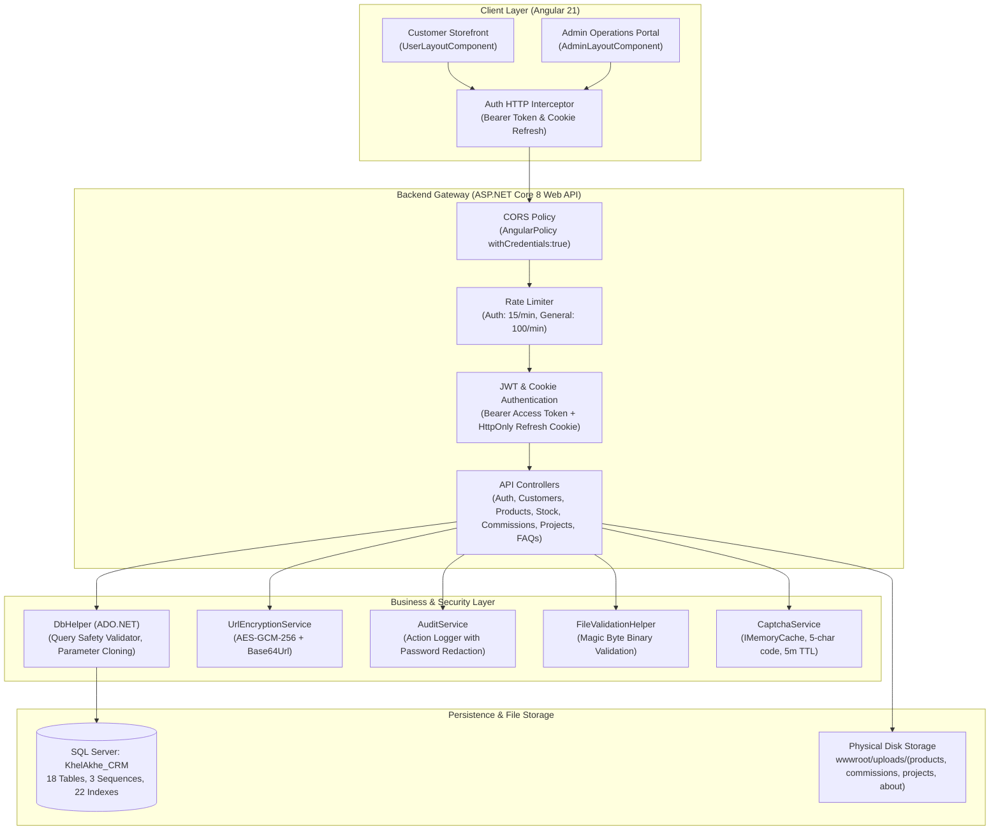
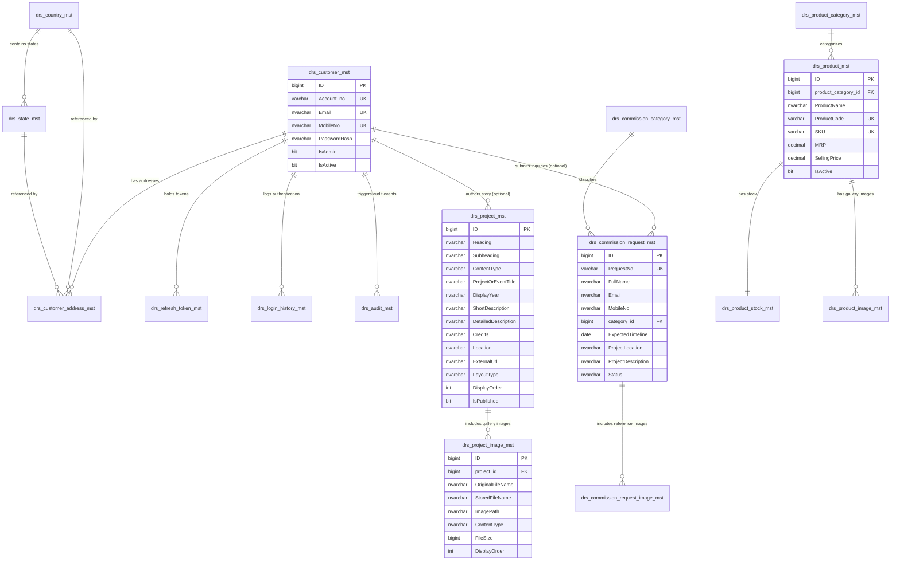

# Khel-Akhel — Complete Project Technical & Functional Documentation

**Document Version:** 1.0.0  
**Audit & Generation Date:** October 14, 2026  
**Status Reference:** Verified against current source code and database migration scripts  
**Frontend Repository Root:** `F:\Projects\Khel-Akhel\Khel-Akhel-Client`  
**Backend Repository Root:** `F:\Projects\Khel-Akhel\Khel-Akhel-Server`  
**Database Scripts Root:** `F:\Projects\Khel-Akhel\DBScripts`  

---

> [!NOTE]
> **Implementation Status Methodology**: All implementation statuses in this document are strictly classified based on deep source code inspection, build verifications (`ng build` and `dotnet build`), and route/controller audits. Differentiations are explicitly maintained between UI components that render, controllers that expose endpoints, fully integrated client-to-server workflows, and unrouted boilerplate stubs.

---

## Table of Contents

1. [Executive Summary](#1-executive-summary)
2. [Business Requirements and Functional Scope](#2-business-requirements-and-functional-scope)
3. [Technology Stack and Architecture](#3-technology-stack-and-architecture)
4. [Repository and Folder Structure](#4-repository-and-folder-structure)
5. [Angular Frontend Documentation](#5-angular-frontend-documentation)
   - 5.1 [Application Setup and Configuration](#51-application-setup-and-configuration)
   - 5.2 [Admin Portal Implementation](#52-admin-portal-implementation)
   - 5.3 [Customer-Facing Storefront Implementation](#53-customer-facing-storefront-implementation)
   - 5.4 [Frontend Routing Inventory](#54-frontend-routing-inventory)
   - 5.5 [Frontend Services and State Management](#55-frontend-services-and-state-management)
   - 5.6 [UI Theme and Design System](#56-ui-theme-and-design-system)
6. [Backend Architecture (.NET 8 Web API)](#6-backend-architecture-net-8-web-api)
7. [Complete Backend Controller and API Inventory](#7-complete-backend-controller-and-api-inventory)
8. [Frontend-to-Backend API Mapping & Integration Audit](#8-frontend-to-backend-api-mapping--integration-audit)
9. [Database Documentation (SQL Server / KhelAkhe_CRM)](#9-database-documentation-sql-server--khelakhe_crm)
   - 9.1 [Database Architecture and Conventions](#91-database-architecture-and-conventions)
   - 9.2 [Complete Table Inventory](#92-complete-table-inventory)
   - 9.3 [Foreign Key Relationships](#93-foreign-key-relationships)
   - 9.4 [Indexes and Performance Constraints](#94-indexes-and-performance-constraints)
   - 9.5 [Database Sequences and Seed Data](#95-database-sequences-and-seed-data)
   - 9.6 [Entity-Relationship Diagram](#96-entity-relationship-diagram)
10. [Authentication, Authorization, and Security](#10-authentication-authorization-and-security)
11. [Commissioned Projects / Custom Project Requests Module](#11-commissioned-projects--custom-project-requests-module)
12. [Dynamic Projects & Visual Gallery Layout Builder Module (with Independent About Us Page)](#12-dynamic-projects--visual-gallery-layout-builder-module-with-independent-about-us-page)
    - 12.1 [Business Workflow & Editorial Narrative Architecture](#121-business-workflow--editorial-narrative-architecture)
    - 12.2 [Visual Gallery Layout Presets](#122-visual-gallery-layout-presets)
    - 12.3 [Image Gallery Editor & Constraints](#123-image-gallery-editor--constraints)
    - 12.4 [Real-Time Live Preview & Standalone Gallery Renderer](#124-real-time-live-preview--standalone-gallery-renderer)
    - 12.5 [Public Storefront Presentation, Lightbox, & Disciplines Grid](#125-public-storefront-presentation-lightbox--disciplines-grid)
    - 12.6 [Database Schema & Backend Persistence](#126-database-schema--backend-persistence)
13. [Current Implementation Status Matrix](#13-current-implementation-status-matrix)
14. [Known Issues, Technical Debt, and Gaps](#14-known-issues-technical-debt-and-gaps)
15. [Prioritized Completion Roadmap](#15-prioritized-completion-roadmap)
16. [Build, Run, and Local Development Guide](#16-build-run-and-local-development-guide)
17. [Testing and Verification Record](#17-testing-and-verification-record)
18. [Change History and Maintenance Protocol](#18-change-history-and-maintenance-protocol)

---

## 1. Executive Summary

### 1.1 Project Overview
**Khel-Akhel** is a contemporary creative studio, design laboratory, and bespoke ecommerce platform created in brand and artistic association with **DARAS**. The venture bridges artisanal material culture, architectural installations, curated home objects, art editions, and custom commissioned projects with modern enterprise software architecture.

The name and philosophy represent a fluid journey where creativity has no rigid boundaries:
> *"All that comes, comes in play. All that flows, flows. All that goes, goes. All is One. Khel-Akhel is a creative journey where art takes many forms, shaped by curiosity, experimentation, and the natural flow of making."*

### 1.2 System Purpose
The application comprises two core interfaces:
1. **Customer-Facing Storefront (`/`)**: A refined, editorial digital experience allowing patrons, collectors, and corporate clients to discover studio collections, explore multi-disciplinary art practices, browse signature series, submit custom commissioned project requests, and manage customer accounts.
2. **Admin Operations Portal (`/admin`)**: An enterprise management dashboard for studio curators and business administrators to oversee customer records, customer delivery addresses, hierarchical product catalogs, product inventory/stock, custom commissioned project requests, dynamic about-the-studio narratives, and FAQ knowledge bases.

### 1.3 Technology Summary
- **Frontend**: Angular 21.2.0 (Standalone Component Architecture, Zoneless/Coalescing Event Detection, Angular Signals, Reactive & Template Forms, Native SCSS Design System).
- **Backend**: ASP.NET Core 8.0 Web API (`net8.0`, C# 12, Scoped SQL Server `DbHelper` access layer, AES-GCM 256-bit URL parameter encryption, HMAC-SHA256 URL signatures, Sliding Rate Limiting, BCrypt password hashing).
- **Database**: Microsoft SQL Server (`KhelAkhe_CRM` database, 18 tables, 3 auto-numbering sequences, 12 foreign key constraints, 22 performance and filtered unique indexes, parameterized T-SQL procedures).
- **Authentication**: Stateless Bearer JWT access tokens paired with cryptographically secure, rotating `HttpOnly` refresh token cookies with automatic token reuse breach detection.

### 1.4 Implementation Maturity & Key Findings
- **Admin Portal**: Highly mature (~90% complete). Customers, Customer Addresses, Categories, Products, Product Images, Product Stock, Commissioned Projects, and Dynamic Projects Management (featuring 7 gallery layout presets, drag-and-drop 15-image uploader with reordering, and real-time live preview) have complete working pages, services, forms, modals, and API integrations.
- **Backend API**: Well-structured and operational (~80% complete for core catalog, inquiries, and editorial narratives). Auth, Customers, Addresses, Locations, Categories, Products, Images, Stock, Commissioned Projects, FAQs, and Projects sections (supporting dynamic `LayoutType` validation and persistence) are fully implemented.
- **Storefront Architecture**: Moderately implemented (~40%). The `UserLayoutComponent` is fully designed with a responsive header, mobile navigation drawer, and footer. Five customer routes (`/`, `/about`, `/products`, `/login`, `/register`) are active in `app.routes.ts`. The public `/projects` page dynamically renders studio showcases, 7 gallery layouts, and full-screen lightbox from `api/projects/public`, while the independent `/about` page presents the studio manifesto, philosophy, and the 12 DARAS Studio Disciplines. Exactly 22 storefront page components exist on disk as boilerplate stubs (`<p>... works!</p>`) and are pending routing and integration.
- **Ecommerce Transaction Pipeline**: Planned / pending backend development. Order placement, Cart synchronization, Wishlist management, Checkout workflows, Payment gateway webhooks, Shipping provider integration, and Invoicing have no backend controllers or database tables implemented.

---

## 2. Business Requirements and Functional Scope

### 2.1 The Twelve Creative Disciplines
As established in studio foundation documentation (`About Khel-Akhel _Draft 01.docx`), Khel-Akhel operates across twelve distinct disciplines that inform its catalog and bespoke requests:
1. **01 — Art & Creative Practice**: Visual art, conceptual art, illustration, calligraphy, sculpture, performance, photography, film, sound, poetry.
2. **02 — Architecture, Spatial & Experiential Design**: Architectural design, interiors, spatial scenography, exhibitions, immersive environments, installations, public spaces.
3. **03 — Craft, Material Culture, Objects & Product Design**: Artisan collaborations, bespoke studio furniture, collectibles, lifestyle objects, material experimentation.
4. **04 — Cultural, Festival & Public Experiences**: Festivals, public exhibitions, cultural programming, immersive public art.
5. **05 — Film, Photography, Sound & Media**: Documentaries, photographic portfolios, audiovisual installations, soundscapes, digital media.
6. **06 — Learning, Play & Facilitation**: Interactive workshops, alternative learning circles, immersive play labs, educational curricula.
7. **07 — Research, Documentation & Knowledge**: Ecological research, cultural preservation archives, art/craft publications, studio methodologies.
8. **08 — Community, Ecology & Cultural Initiatives**: Grassroots community initiatives, participatory regenerative art, ecological design.
9. **09 — Creative Consultancy & Direction**: Creative direction, art curation, strategic brand consultancy, experience design.
10. **10 — Publishing & Content**: Curated books, editorial publications, digital learning content, documentary films.
11. **11 — Commercial Products & Licensing**: Direct commercialization, manufacture, retail distribution, IP licensing.
12. **12 — Intellectual Property & Collaborations**: Copyrights, registered trademarks, collaborative commissions, partnerships, joint ventures.

### 2.2 Ecommerce & Product Catalog Scope
The product catalog is structured to handle diverse, non-standard creative goods:
- **Art Prints & Postcards**: Limited edition numbered prints, standard edition prints, fine-art postcards, framing options.
- **Photographs**: Original photographic prints with custom framing and dimension specifications.
- **Lamps & Sculptural Luminaires**: Handcrafted table lamps, floor lamps, sculptural lighting objects.
- **Murals & Wall Art**: Studio wall murals, textured decorative wall art, acoustic artistic paneling.
- **Sculptures**: 3D artistic works in metal, stone, reclaimed wood, ceramics, and mixed media.
- **Bespoke Furniture**: Custom studio chairs, side tables, accent consoles, artistic statement furniture.
- **Wearables & Clothing**: Limited-run studio apparel, artistic scarves, bespoke textiles.
- **Bags & Accessories**: Handcrafted leather/canvas totes, studio carriers, lifestyle cases.
- **Gifting & Corporate Collections**: Curated gifting packages, corporate event bespoke packages (modeled on premium lifestyle gifting workflows).

### 2.3 Custom Commissioned Projects Scope
For clients requesting works that cannot be purchased off-the-shelf, the application provides an end-to-end inquiry workflow:
- Detailed inquiry capture (Timeline, Location, Word-limited Description, Keywords).
- Multi-file image sketch/reference uploads (maximum 3 images, 5MB each).
- Auto-generated business tracking sequence (`COMM-yyyyMMdd-XXXX`).
- Administrator review, status progression (`Submitted` $\rightarrow$ `Under Review` $\rightarrow$ `Contacted` $\rightarrow$ `In Progress` $\rightarrow$ `Completed` / `Rejected` / `Cancelled`), and internal notes logging.

---

## 3. Technology Stack and Architecture

### 3.1 Technology Matrix

| Layer | Technology | Version | Purpose / Detail |
|---|---|---|---|
| **Frontend Framework** | Angular | `21.2.0` | Modern standalone component architecture without NgModules |
| **Frontend Build Tool** | `@angular/build` | `21.2.9` | Vite + esbuild modern application pipeline |
| **Language (Client)** | TypeScript | `~5.9.2` | Strict typing, ECMAScript 2022 output |
| **Styling** | SCSS | Dart Sass | CSS Custom Properties design system with Warm Editorial palette |
| **Client Test Runner** | Vitest | `^4.0.8` | Next-generation unit testing framework (configured with `jsdom 28.0.0`) |
| **Backend Framework** | ASP.NET Core | `8.0` (`net8.0`) | High-performance C# Web API |
| **Data Access** | ADO.NET / `Microsoft.Data.SqlClient` | `5.2.2` | Custom `DbHelper` with query safety validation and parameterized execution |
| **Authentication** | `Microsoft.AspNetCore.Authentication.JwtBearer` | `8.0.8` | Stateless JWT Bearer tokens |
| **Password Hashing** | `BCrypt.Net-Next` | `4.0.3` | Salted Blowfish password hashing |
| **API Documentation** | Swashbuckle (Swagger) | `6.6.2` | Interactive OpenAPI 3.0 UI |
| **Database Server** | Microsoft SQL Server | 2019 / 2022 / LocalDB | Relational storage (`KhelAkhe_CRM`) |

### 3.2 High-Level Architecture Diagram



---

## 4. Repository and Folder Structure

### 4.1 Root Structure
```text
F:\Projects\Khel-Akhel
├── .git/                                   # Git repository tracking
├── .github/                                # GitHub automation & issue templates
├── About Khel-Akhel _Draft 01.docx         # Brand foundation & 12 disciplines reference
├── DBScripts/                              # Database initialization & migration scripts
├── Khel - akhel documentation.txt          # Original notes, catalog categories, wireframe requirements
├── Khel-Akhel-Client/                      # Angular 21 frontend project
├── Khel-Akhel-Server/                      # ASP.NET Core 8 Web API project
└── KHEL-AKHEL-PROJECT-DOCUMENTATION.md      # Master technical documentation
```

### 4.2 Frontend Directory Tree (`Khel-Akhel-Client`)
```text
Khel-Akhel-Client/src/
├── app/
│   ├── admin/                              # Admin Operations Portal
│   │   ├── layouts/
│   │   │   └── admin-layout/               # Admin shell with collapsible sidebar & topbar
│   │   ├── models/                         # DTO interfaces for Admin domain
│   │   │   ├── project.model.ts              # Project content, image, layout presets, and DTOs
│   │   │   ├── commissioned-project.model.ts
│   │   │   ├── customer.model.ts
│   │   │   ├── customer-address.model.ts
│   │   │   ├── product.model.ts
│   │   │   ├── product-category.model.ts
│   │   │   ├── product-image.model.ts
│   │   │   └── product-stock.model.ts
│   │   ├── pages/                          # Admin feature components
│   │   │   ├── about/                      # Studio narrative & gallery layout management
│   │   │   │   ├── about-list/             # Search, discipline filter, publish toggle, preview
│   │   │   │   ├── about-form/             # Reactive form, tabbed layout & gallery editor
│   │   │   │   ├── gallery-layout-selector/# 7 visual layout preset wireframe picker
│   │   │   │   └── image-gallery-editor/   # Drag-and-drop 15-img uploader & reordering
│   │   │   ├── commissioned-projects/      # Inquiries list, filter, preview, status modal
│   │   │   ├── customer-addresses/         # Customer delivery address manager
│   │   │   ├── customers/                  # Customers list, add-customer, customer-detail
│   │   │   ├── dashboard/                  # KPI overview aggregated from services
│   │   │   ├── login/                      # Admin credentials & captcha login
│   │   │   ├── product-categories/         # Category list & add-category
│   │   │   ├── product-stock/              # Stock list & update-stock
│   │   │   └── products/                   # Product catalog list, add-product, product-detail
│   │   └── services/                       # Admin HTTP service layer (admin-project.service, etc.)
│   ├── common/                             # Shared enterprise infrastructure
│   │   ├── components/                     # Reusable UI elements
│   │   │   ├── app-loader/                 # Animated page & card loading spinner
│   │   │   ├── breadcrumb/                 # Navigational breadcrumb trail
│   │   │   ├── confirmation-dialog/        # Modal confirmation prompt
│   │   │   ├── error-pages/                # 403 Forbidden, 404 Not Found, 500 Server Error,
│   │   │   │                               # 503 Unavailable, Maintenance
│   │   │   ├── gallery-renderer/           # Standalone multi-layout gallery & lightbox modal
│   │   │   ├── pagination/                 # Standardized paginator with page-size selector
│   │   │   └── unauthorized/               # 401 Unauthorized display
│   │   ├── constants/                      # Regex patterns (Email, Mobile, Pincode)
│   │   ├── guards/                         # adminGuard, authGuard, userGuard
│   │   ├── interceptors/                   # authInterceptor (JWT header & HttpOnly refresh)
│   │   ├── models/                         # ApiResponse, Auth, Breadcrumb, Location models
│   │   ├── pipes/                          # safe-html pipe
│   │   ├── services/                       # ApiService, AuthService, LocationService,
│   │   │                                   # UrlEncryptionService, UrlSignatureService
│   │   ├── utils/                          # String and formatting utilities
│   │   └── validators/                     # Form group & field custom validators
│   ├── user/                               # Customer Storefront Portal
│   │   ├── layouts/
│   │   │   └── user-layout/                # Storefront header, mobile drawer, footer
│   │   ├── models/                         # User domain models (user-product.model.ts)
│   │   ├── pages/                          # Customer pages
│   │   │   ├── about/                      # Implemented dynamic studio philosophy, 7 layouts, 12 disciplines, lightbox
│   │   │   ├── account/                    # (8 Stubs: overview, password, profile, invoices,
│   │   │   │                               #  addresses, order-detail, orders, track-order)
│   │   │   ├── cart/                       # (Stub: <p>cart works!</p>)
│   │   │   ├── checkout/                   # (Stub: <p>checkout works!</p>)
│   │   │   ├── contact/                    # (Stub: <p>contact works!</p>)
│   │   │   ├── faq/                        # (Stub: <p>faq works!</p>)
│   │   │   ├── forgot-password/            # (Stub: <p>forgot-password works!</p>)
│   │   │   ├── home/                       # Implemented editorial home landing page
│   │   │   ├── login/                      # Implemented customer login page
│   │   │   ├── policies/                   # (5 Stubs: cookie, privacy, refund, returns, terms)
│   │   │   ├── press/                      # (Stub: <p>press works!</p>)
│   │   │   ├── product-detail/             # (Stub: <p>product-detail works!</p>)
│   │   │   ├── products/                   # Implemented customer product gallery
│   │   │   ├── register/                   # Implemented customer registration form
│   │   │   ├── shop/                       # (Stub: <p>shop works!</p>)
│   │   │   └── wishlist/                   # (Stub: <p>wishlist works!</p>)
│   │   └── services/                       # user-product.service, user-project.service,
│   │                                       # cart-state (stub), wishlist-state (stub)
│   ├── app.config.ts                       # Application providers (Router, Interceptors)
│   ├── app.routes.ts                       # Angular route configuration
│   └── app.ts                              # Root component (<router-outlet />)
├── environments/                           # environment.ts & environment.prod.ts
└── styles/                                 # Theme SCSS files
    ├── admin-theme.scss                    # Admin tokens & components
    └── user-theme.scss                     # Storefront editorial tokens
```

### 4.3 Backend Directory Tree (`Khel-Akhel-Server`)
```text
Khel-Akhel-Server/
├── BL/                                     # Business Logic & Infrastructure
│   ├── Common/
│   │   ├── Audit.cs                        # Static audit caller
│   │   ├── DataTableMapper.cs              # Reflection/DataRow mapping helper
│   │   ├── DateTimeFormat.cs               # Standardized ISO date-time string formatter
│   │   ├── DBHelper.cs                     # ADO.NET SQL Server manager with safety check
│   │   ├── FileValidationHelper.cs         # Magic-byte binary image validator
│   │   ├── JwtHelper.cs                    # HMAC-SHA256 JWT builder
│   │   ├── Logs.cs                         # Daily rolling file logger & log retention
│   │   ├── PasswordHelper.cs               # BCrypt password hashing & verifier
│   │   └── ValidationHelper.cs             # Email, Mobile, Pincode regex validators
│   └── Services/
│       ├── AuditService.cs                 # drs_audit_mst writer with password sanitization
│       ├── CaptchaService.cs               # In-memory captcha code generator & validator
│       ├── RefreshTokenService.cs          # drs_refresh_token_mst token rotation manager
│       ├── UrlEncryptionService.cs         # AES-GCM-256 authenticated ID encryptor
│       └── UrlSignatureService.cs          # HMAC-SHA256 URL integrity signer
├── Controllers/
│   ├── Projects/ProjectsController.cs    # Dynamic project showcase & portfolio endpoints
│   ├── Auth/AuthController.cs              # Login, Captcha, Refresh, Logout, Password APIs
│   ├── commissionedProjects/
│   │   └── commissionsController.cs        # Bespoke project inquiries & review endpoints
│   ├── Customer/
│   │   ├── CustomerAddressController.cs    # Customer address management
│   │   └── CustomerController.cs           # Customer profile management
│   ├── FAQs/FAQController.cs               # Studio FAQ endpoints (Public & Admin)
│   ├── LocationMaster/LocationMaster.cs    # Country and State master endpoints
│   └── Product/
│       ├── ProductCategoryController.cs    # Category management endpoints
│       ├── ProductController.cs            # Product catalog & public search endpoints
│       ├── ProductImageController.cs       # Product gallery image upload endpoints
│       └── ProductStockController.cs       # Inventory & stock adjustment endpoints
├── Models/                                 # Request models, DTOs, and CommonResponse
│   ├── ProjectModels.cs
│   ├── AuthModels.cs
│   ├── CommissionModels.cs
│   ├── CommonResponse.cs
│   ├── CustomerAddressModels.cs
│   ├── CustomerModels.cs
│   ├── FaqModels.cs
│   ├── LocationModels.cs
│   ├── ProductCategoryModels.cs
│   ├── ProductImageModels.cs
│   ├── ProductModels.cs
│   └── ProductStockModels.cs
├── wwwroot/
│   └── uploads/                            # Uploaded image files (products, commissions, about)
├── appsettings.json                        # Connection string, JWT parameters, CORS origins
├── Khel-Akhel-Server.csproj                # .NET 8 project configuration
└── Program.cs                              # Application startup, DI container, middleware pipeline
```

### 4.4 Database Scripts Directory (`DBScripts`)
```text
DBScripts/
├── ProductScript-CreateTAbles.sql          # 18 Table definitions, 3 Sequences, Alter scripts
├── ProductScript-Foreignkeys.sql           # 12 Foreign key constraints
├── ProductScript-Indexes.sql               # 22 Filtered unique & performance indexes
└── ProductScript-SeedData.sql              # Master seeds (Countries, States, Categories, Messages)
```

---

## 5. Angular Frontend Documentation

### 5.1 Application Setup and Configuration
- **Application Bootstrap**: Standalone application configuration initialized in `main.ts` using `bootstrapApplication(App, appConfig)`.
- **Global Providers (`app.config.ts`)**:
  - `provideZoneChangeDetection({ eventCoalescing: true })`: Improves change detection performance by batching browser events.
  - `provideBrowserGlobalErrorListeners()`: Traps unhandled script errors.
  - `provideRouter(routes)`: Configures client-side routing.
  - `provideHttpClient(withInterceptors([authInterceptor]))`: Injects HTTP client with global JWT authorization headers and refresh-token handling.
- **Environment**: Configured in `src/environments/environment.ts` with `apiBaseUrl: 'https://localhost:7095/api'`.

### 5.2 Admin Portal Implementation

The Admin Portal is protected by `adminGuard` and rendered inside `AdminLayoutComponent`.

1. **Admin Login (`/admin/login`)**:
   - **Path**: `src/app/admin/pages/login/login.ts`
   - **Responsibilities**: Authenticates administrators using Email, Password, and a dynamic Captcha. Displays animated SVG captcha with instant reload capability.
   - **Service Integration**: Calls `AuthService.getCaptcha()` and `AuthService.login()`.
   - **Status**: Implemented and verified.

2. **Admin Dashboard (`/admin/dashboard`)**:
   - **Path**: `src/app/admin/pages/dashboard/dashboard.ts`
   - **Responsibilities**: High-level administrative pulse showing KPI counters (Total Customers, Categories, Products, Stock Records, Commission Requests) and a list of recently added products.
   - **Service Integration**: Executes a client-side `forkJoin` across `AdminCustomerService`, `AdminProductCategoryService`, `AdminProductService`, `AdminProductStockService`, and `AdminCommissionedProjectService`.
   - **Status**: Implemented and verified.

3. **Customers Management (`/admin/customers`)**:
   - **Path**: `src/app/admin/pages/customers/customers.ts`
   - **Responsibilities**: Searchable, paginated customer table. Features debounced live search, active/inactive filters, customer detail navigation, and soft-delete prompts.
   - **Add Customer (`/admin/customers/add`)**: Reactive form validating First Name, Last Name, Email, Mobile, and Password with confirmation dialog.
   - **Customer Detail (`/admin/customers/:encryptedId`)**: Displays comprehensive customer account information, verification status, and linked addresses.
   - **Status**: Implemented and verified.

4. **Customer Addresses (`/admin/customer-addresses`)**:
   - **Path**: `src/app/admin/pages/customer-addresses/customer-addresses.ts`
   - **Responsibilities**: Address inventory table displaying Full Name, Mobile, Street Address, City, State, Country, Pincode, and Default address status.
   - **Status**: Implemented and verified.

5. **Product Categories (`/admin/product-categories`)**:
   - **Path**: `src/app/admin/pages/product-categories/product-categories.ts`
   - **Responsibilities**: Categorization management displaying Category Name, Description, Display Order, and Active badge.
   - **Add Category (`/admin/product-categories/add`)**: Reactive form to register new categories.
   - **Status**: Implemented and verified.

6. **Products Management (`/admin/products`)**:
   - **Path**: `src/app/admin/pages/products/products.ts`
   - **Responsibilities**: Product catalog table with SKU, Product Code, Selling Price, MRP, Category badge, and status flags.
   - **Add Product (`/admin/products/add`)**: Multi-section product creation form with automated SKU generation, price validation, category dropdown, and image upload.
   - **Product Detail (`/admin/products/:encryptedId`)**: Full product view with gallery image uploader, default image selector, and image deletion.
   - **Status**: Implemented and verified.

7. **Product Stock (`/admin/product-stock`)**:
   - **Path**: `src/app/admin/pages/product-stock/product-stock.ts`
   - **Responsibilities**: Inventory monitoring grid highlighting low-stock items ($\le 5$ units), available quantity, and reserved quantity.
   - **Update Stock (`/admin/product-stock/update`)**: Form to adjust available and reserved stock by selecting an existing product.
   - **Status**: Implemented and verified.

8. **Commissioned Projects (`/admin/commissioned-projects`)**:
   - **Path**: `src/app/admin/pages/commissioned-projects/commissioned-projects.ts`
   - **Responsibilities**: Full-featured bespoke project inquiry portal. Includes debounced search, category filter, status filter, date range filter, sort order selector, inquiry detail modal, full-screen image lightbox, and status/notes update dialog.
   - **Status**: Implemented and verified.

9. **Projects Management (`/admin/projects`)**:
   - **Path**: `src/app/admin/pages/about/about-list/about-list.ts`, `src/app/admin/pages/about/about-form/about-form.ts`
   - **Responsibilities**: Full studio narrative and visual portfolio layout manager:
     - **List View (`/admin/about`)**: Searchable list with discipline/content-type filter, publication status toggle (`PATCH api/about/{id}/publish`), display order visualization, quick visual preview modal, and delete action.
     - **Create/Edit Form (`/admin/projects/create`, `/admin/about/edit/:encryptedAboutId`)**: Tabbed interface featuring reactive metadata inputs (Heading, Subheading, Content Discipline / Category as a clean manual text input with no dropdown, Year, Descriptions, Credits, Location, External Link), layout selection, gallery editor, and live preview.
     - **Layout Selector (`gallery-layout-selector`)**: Visual wireframe selector supporting all 7 layout presets (`grid-3`, `grid-2`, `editorial`, `featured`, `full-width`, `masonry`, `asymmetric`).
     - **Image Gallery Editor (`image-gallery-editor`)**: Drag-and-drop file uploader (up to 15 images, 5MB each, binary image validation), visual 15-image counter badge, drag-and-drop reordering, move up/down controls, and deletion tracking.
     - **Live Preview Tab**: Instant client-side preview rendering the exact public layout, narrative text, metadata badges, and lightbox modal before publishing.
   - **Service Integration**: `AdminAboutService` (multipart `FormData` uploads, reordering, publishing, deletions).
   - **Status**: Implemented and verified.

### 5.3 Customer-Facing Storefront Implementation

The Storefront is hosted under `UserLayoutComponent` with an editorial layout celebrating authentic craft and design associated with DARAS.

1. **Home Page (`/`)**:
   - **Path**: `src/app/user/pages/home/home.ts`
   - **Template**: `home.html` (36 lines)
   - **Content**: Hero banner introducing the Khel-Akhel studio journey, signature collection previews, and CTA links.
   - **Status**: Implemented and verified.

2. **About & Studio Ethos (`/about`)**:
   - **Path**: `src/app/user/pages/about/about.ts`
   - **Template**: `about.html`, `about.scss`
   - **Content**: Refined editorial studio story and portfolio page reflecting the DARAS aesthetic:
     - Hero manifesto displaying the Khel-Akhel philosophy (*"All that comes, comes in play. All that flows, flows. All that goes, goes. All is One."*).
     - Dynamic section loop rendering published entries in `DisplayOrder`.
     - `GalleryRendererComponent` rendering media in the chosen layout preset (`grid-3`, `grid-2`, `editorial`, `featured`, `full-width`, `masonry`, `asymmetric`).
     - Full-screen lightbox modal with thumbnail strip, counter, and keyboard navigation (`Escape`, `ArrowLeft`, `ArrowRight`).
     - The Twelve DARAS Studio Disciplines interactive grid.
     - Bespoke commission inquiry CTA banner.
   - **Service Integration**: Consumes `UserAboutService.getPublicSections()`.
   - **Status**: Implemented and verified.

3. **Products Gallery (`/products`)**:
   - **Path**: `src/app/user/pages/products/products.ts`
   - **Template**: `products.html` (41 lines)
   - **Content**: Public product catalog grid displaying images, titles, pricing, and category filters. Consumes `UserProductService.getPublicProducts()`.
   - **Status**: Implemented and verified.

4. **Customer Login (`/login`)**:
   - **Path**: `src/app/user/pages/login/login.ts`
   - **Template**: `login.html` (42 lines)
   - **Content**: Secure customer authentication form.
   - **Status**: Implemented and verified.

5. **Customer Registration (`/register`)**:
   - **Path**: `src/app/user/pages/register/register.ts`
   - **Template**: `register.html` (64 lines)
   - **Content**: Registration form capturing First Name, Last Name, Email, Mobile, and Password with validation feedback.
   - **Status**: Implemented and verified.

6. **Storefront Boilerplate Stubs (22 Unrouted Components)**:
   - The following 22 components exist under `src/app/user/pages/` containing only single-line `<p>... works!</p>` CLI stubs and are **not registered in `app.routes.ts`**:
     - `account/account-overview`, `account/change-password`, `account/edit-profile`, `account/invoices`, `account/manage-addresses`, `account/order-detail`, `account/orders`, `account/track-order`, `cart`, `checkout`, `contact`, `faq`, `forgot-password`, `policies/cookie-policy`, `policies/privacy-policy`, `policies/refund-policy`, `policies/returns-policy`, `policies/terms-conditions`, `press`, `product-detail`, `shop`, `wishlist`. (`about` was previously in this list and has been fully implemented and routed).
   - **Status**: Planned / Stubs only (Orphaned from routing).

### 5.4 Frontend Routing Inventory

| Route | Layout | Component | Access Guard | Main Purpose | Status |
|---|---|---|---|---|---|
| `/admin/login` | None (Blank) | `AdminLoginComponent` | Public | Admin portal credentials & captcha login | Implemented and verified |
| `/admin` | `AdminLayoutComponent` | *Redirect to `/admin/dashboard`* | `adminGuard` | Default admin entry point | Implemented and verified |
| `/admin/dashboard` | `AdminLayoutComponent` | `AdminDashboardComponent` | `adminGuard` | Studio operations KPI dashboard | Implemented and verified |
| `/admin/customers` | `AdminLayoutComponent` | `CustomersComponent` | `adminGuard` | Customer account directory & search | Implemented and verified |
| `/admin/customers/add` | `AdminLayoutComponent` | `AddCustomerComponent` | `adminGuard` | Manual customer creation form | Implemented and verified |
| `/admin/customers/:encryptedId` | `AdminLayoutComponent` | `CustomerDetailComponent` | `adminGuard` | Customer profile & addresses view | Implemented and verified |
| `/admin/customer-addresses` | `AdminLayoutComponent` | `CustomerAddressesComponent` | `adminGuard` | Customer delivery addresses directory | Implemented and verified |
| `/admin/product-categories` | `AdminLayoutComponent` | `ProductCategoriesComponent` | `adminGuard` | Catalog category directory | Implemented and verified |
| `/admin/product-categories/add` | `AdminLayoutComponent` | `AddCategoryComponent` | `adminGuard` | New category creation form | Implemented and verified |
| `/admin/products` | `AdminLayoutComponent` | `ProductsComponent` | `adminGuard` | Master product catalog table | Implemented and verified |
| `/admin/products/add` | `AdminLayoutComponent` | `AddProductComponent` | `adminGuard` | New product registration form | Implemented and verified |
| `/admin/products/:encryptedId` | `AdminLayoutComponent` | `ProductDetailComponent` | `adminGuard` | Product details & gallery management | Implemented and verified |
| `/admin/product-stock` | `AdminLayoutComponent` | `ProductStockComponent` | `adminGuard` | Inventory & low-stock monitoring | Implemented and verified |
| `/admin/product-stock/update` | `AdminLayoutComponent` | `UpdateStockComponent` | `adminGuard` | Inventory quantity adjustment form | Implemented and verified |
| `/admin/commissioned-projects` | `AdminLayoutComponent` | `CommissionedProjectsComponent` | `adminGuard` | Bespoke project inquiries dashboard | Implemented and verified |
| `/admin/about` | `AdminLayoutComponent` | `ProjectListComponent` | `adminGuard` | Studio narrative directory, filters & status toggle | Implemented and verified |
| `/admin/projects/create` | `AdminLayoutComponent` | `ProjectFormComponent` | `adminGuard` | Create About section with layout presets & image gallery | Implemented and verified |
| `/admin/about/edit/:encryptedAboutId` | `AdminLayoutComponent` | `ProjectFormComponent` | `adminGuard` | Edit About section, layout presets, image gallery & reordering | Implemented and verified |
| `/admin/**` | `AdminLayoutComponent` | `NotFoundComponent` | `adminGuard` | Admin child wildcard 404 handler | Implemented and verified |
| `/` | `UserLayoutComponent` | `UserHomeComponent` | Public | Storefront landing page & studio ethos | Implemented and verified |
| `/about` | `UserLayoutComponent` | `About` | Public | Dynamic studio narrative, 7 visual layouts, lightbox & 12 disciplines | Implemented and verified |
| `/products` | `UserLayoutComponent` | `UserProductsComponent` | Public | Public studio product catalog gallery | Implemented and verified |
| `/login` | `UserLayoutComponent` | `UserLoginComponent` | Public | Customer account sign-in | Implemented and verified |
| `/register` | `UserLayoutComponent` | `UserRegisterComponent` | Public | New customer account registration | Implemented and verified |
| `/unauthorized` | None (Blank) | `UnauthorizedComponent` | Public | 401/403 access denial error display | Implemented and verified |
| `/**` | None (Blank) | `NotFoundComponent` | Public | Global wildcard 404 handler | Implemented and verified |
| *`/shop`* | *N/A* | *Unrouted* | *None* | *Targeted by header/footer navigation* | Frontend only (404 runtime) |
| *`/contact`* | *N/A* | *Unrouted* | *None* | *Targeted by header/footer navigation* | Frontend only (404 runtime) |
| *`/wishlist`* | *N/A* | *Unrouted* | *None* | *Targeted by header/footer navigation* | Frontend only (404 runtime) |
| *`/cart`* | *N/A* | *Unrouted* | *None* | *Targeted by header/footer navigation* | Frontend only (404 runtime) |
| *`/checkout`* | *N/A* | *Unrouted* | *None* | *Planned checkout workflow* | Planned / not implemented |
| *`/orders`* | *N/A* | *Unrouted* | *None* | *Targeted by footer navigation* | Planned / not implemented |
| *`/faq`* | *N/A* | *Unrouted* | *None* | *Targeted by footer navigation* | Frontend only (404 runtime) |

### 5.5 Frontend Services and State Management

| Service / State File | Location | Dependencies | APIs Consumed | Storage Behavior | Error Handling | Status |
|---|---|---|---|---|---|---|
| `ApiService` | `src/app/common/services/api.service.ts` | `HttpClient` | All backend endpoints | In-memory only (`withCredentials: true` on all requests) | Returns raw `Observable<ApiResponse<T>>` | Implemented and verified |
| `AuthService` | `src/app/common/services/auth.service.ts` | `ApiService`, `Router` | `auth/captcha`, `auth/login`, `auth/refresh`, `auth/logout`, `auth/forgot-password` | In-memory Angular Signals (`currentUser`, `accessToken$`). No tokens in `localStorage`. | Handles silent background refresh on 401 | Implemented and verified |
| `LocationService` | `src/app/common/services/location.service.ts` | `ApiService` | `location/countries`, `location/states` | None | Propagates `ApiResponse` | Implemented and verified |
| `UrlEncryptionService` | `src/app/common/services/url-encryption.service.ts` | None | None | Client-side validation only | Pattern match regex (`/^[a-zA-Z0-9_-]+$/`) | Implemented and verified |
| `UrlSignatureService` | `src/app/common/services/url-signature.service.ts` | None | None | Client-side validation only | Timestamp skew & hex check | Implemented and verified |
| `AdminCommissionedProjectService` | `src/app/admin/services/admin-commissioned-project.service.ts` | `ApiService` | `commissions/categories`, `commissions/list`, `commissions/{id}`, `commissions/update-status` | None | Propagates `ApiResponse` | Implemented and verified |
| `AdminCustomerService` | `src/app/admin/services/admin-customer.service.ts` | `ApiService` | `customer/list`, `customer/{id}`, `customer/create`, `customer/update/{id}`, `customer/delete/{id}` | None | Propagates `ApiResponse`. *Note: `toggleActive` endpoint missing on backend.* | Partially implemented |
| `AdminCustomerAddressService` | `src/app/admin/services/admin-customer-address.service.ts` | `ApiService` | `customer-address/list`, `customer-address/{id}`, `customer-address/create`, `customer-address/update`, `customer-address/delete/{id}` | None | Propagates `ApiResponse`. *Note: `toggleActive` endpoint missing on backend.* | Partially implemented |
| `AdminProductCategoryService` | `src/app/admin/services/admin-product-category.service.ts` | `ApiService` | `product-category/list`, `product-category/{id}`, `product-category/create`, `product-category/update`, `product-category/delete/{id}` | None | Propagates `ApiResponse` | Implemented and verified |
| `AdminProductService` | `src/app/admin/services/admin-product.service.ts` | `ApiService` | `product/list`, `product/{id}`, `product/create`, `product/update`, `product/delete/{id}` | None | Propagates `ApiResponse` | Implemented and verified |
| `AdminProductImageService` | `src/app/admin/services/admin-product-image.service.ts` | `ApiService` | `product-image/upload`, `product-image/{id}`, `product-image/set-default`, `product-image/{id}` (DELETE) | Multipart `FormData` | Propagates `ApiResponse` | Implemented and verified |
| `AdminProductStockService` | `src/app/admin/services/admin-product-stock.service.ts` | `ApiService` | `product-stock/list`, `product-stock/add`, `product-stock/update` | None | Propagates `ApiResponse`. *Note: `getById` endpoint missing on backend.* | Partially implemented |
| `AdminAboutService` | `src/app/admin/services/admin-project.service.ts` | `ApiService` | `about/list`, `about/{id}`, `about/create`, `about/update`, `about/{id}/publish`, `about/delete/{id}`, `about/images/upload`, `about/images/{id}`, `about/images/reorder` | In-memory / Multipart `FormData` | Propagates `ApiResponse` | Implemented and verified |
| `UserProductService` | `src/app/user/services/user-product.service.ts` | `ApiService` | `product/search`, `product/{id}` | None | Propagates `ApiResponse` | Implemented and verified |
| `UserAboutService` | `src/app/user/services/user-project.service.ts` | `ApiService` | `about/public` | None | Propagates `ApiResponse` | Implemented and verified |
| `CartState` | `src/app/user/services/cart-state.ts` | None | None | Empty class stub | None | Planned / not implemented |
| `WishlistState` | `src/app/user/services/wishlist-state.ts` | None | None | Empty class stub | None | Planned / not implemented |

### 5.6 UI Theme and Design System

The Khel-Akhel design system is implemented in SCSS using CSS Custom Properties and modular theme files (`styles.scss`, `admin-theme.scss`, `user-theme.scss`):

- **Brand Color Tokens**:
  - Deep Navy: `#1F3557` (Primary brand anchor, header accents, high-priority buttons).
  - Dark Navy: `#162A45` (Hover state for primary actions).
  - Terracotta: `#B45132` (Primary warm accent, callouts, active links).
  - Terracotta Hover: `#923F28`.
  - Lustrous Ochre: `#D9A441` (Craft and studio material accent).
  - Studio Teal: `#2D7370` (Success indicators, verified badges).
  - Olive: `#737B4C` (Natural material accent).
  - Error Red: `#A83F32` (Form validation errors, danger actions).
- **Surfaces & Backgrounds**:
  - Warm Canvas / Ivory: `#F5F1E8` (Global application background).
  - Elevated Card Surface: `#FBF9F4` (Clean card panels, modals).
  - Subtle Surface Alt: `#F1E7D5` (Table hover states, badges, filters).
  - Border Tone: `#D9D3C6` (Card boundaries, dividers).
- **Typography**:
  - Headings: `Georgia, 'Times New Roman', serif` (Warm editorial serif voice).
  - Body & UI Controls: `'Inter', system-ui, -apple-system, sans-serif` (Clean legibility).
  - Primary Text: `#1E2430` (High contrast, WCAG AAA compliant).
  - Secondary Text: `#6B6A63` (Meta descriptions, table labels).
- **Table System**:
  - Clean responsive wrapping with specialized layout classes: `.col-id`, `.col-code`, `.col-name`, `.col-email`, `.col-phone`, `.col-category`, `.col-desc`, `.col-numeric`, `.col-badge`, `.col-actions`.
  - Overflow controls: `.text-wrap-natural` and `.text-wrap-anywhere` prevent email and UUID clipping.

---

## 6. Backend Architecture (.NET 8 Web API)

### 6.1 Application Startup & Middleware Pipeline (`Program.cs`)
The backend is structured around a streamlined ASP.NET Core 8 minimal hosting model:
1. **Dependency Injection**:
   - `DbHelper`: Scoped ADO.NET SQL Server manager.
   - `IUrlEncryptionService` / `UrlEncryptionService`: Scoped AES-GCM-256 identifier encryption.
   - `IUrlSignatureService` / `UrlSignatureService`: Scoped HMAC-SHA256 URL integrity signer.
   - `IAuditService` / `AuditService`: Scoped audit log recorder.
   - `IRefreshTokenService` / `RefreshTokenService`: Scoped token rotation manager.
   - `ICaptchaService` / `CaptchaService`: Singleton in-memory captcha generator.
2. **Rate Limiting**:
   - Fixed-window rate limiters configured via `Microsoft.AspNetCore.RateLimiting`:
     - Policy `authentication` / `AuthPolicy`: 15 requests per minute, queue limit 3.
     - Policy `GeneralPolicy`: 100 requests per minute, queue limit 10.
3. **CORS Pipeline**:
   - Named policy `"AngularPolicy"` specifically bound to `http://localhost:4200` with `AllowCredentials()`, `AllowAnyHeader()`, and `AllowAnyMethod()`.
4. **Middleware Order**:
   - `Logs.CleanupOldLogs(45)` $\rightarrow$ `UseSwagger()` $\rightarrow$ `UseCors("AngularPolicy")` $\rightarrow$ `UseStaticFiles()` $\rightarrow$ `UseRateLimiter()` $\rightarrow$ `UseAuthentication()` $\rightarrow$ `UseAuthorization()` $\rightarrow$ `MapControllers()`.

### 6.2 Data Access Layer (`DbHelper.cs`)
Data operations bypass heavy ORMs in favor of direct parameterized ADO.NET execution via `DbHelper`:
- **Query Safety Validator**: Every query passed to `ExecuteQuery`, `ExecuteNonQuery`, or `ExecuteScalar` is checked against a blacklist of forbidden DDL/administrative commands (`ALTER`, `DROP`, `CREATE`, `BACKUP`, `RESTORE`) using case-insensitive regex word boundaries (`\bKEYWORD\b`).
- **Parameter Cloning**: `SqlParameter` objects are explicitly cloned before command addition to ensure thread-safety across concurrent query executions.
- **Transaction Support**: Provides `GetOpenConnectionAsync()` for multi-step atomic operations (e.g. creating a record and persisting associated image rows).

### 6.3 Security Mechanisms
- **Identifier Obfuscation**: Database numeric IDs (`BIGINT`) are never exposed directly over the wire. Instead, `UrlEncryptionService` encrypts IDs into URL-safe Base64 strings using AES-GCM (12-byte IV, 16-byte authentication tag).
- **Password Security**: Managed via `PasswordHelper` using salted BCrypt. Plain-text verification fallback exists only for initial un-hashed seeds.
- **File Upload Security**: `FileValidationHelper` inspects both the MIME type and the binary magic bytes (JPEG: `FF D8`, PNG: `89 50 4E 47`, WEBP: `RIFF....WEBP`) to prevent malicious executable masquerading.

---

## 7. Complete Backend Controller and API Inventory

| Controller | HTTP Method | Route | Access Requirements | Request Parameters / Body | Response Type | Purpose / Description | Status |
|---|---|---|---|---|---|---|---|
| **AuthController** | `GET` | `api/auth/captcha` | Anonymous | None | `ApiResponse<CaptchaResponseData>` | Generates 5-char randomized captcha code and unique `captchaId` | Implemented and verified |
| **AuthController** | `POST` | `api/auth/login` | Anonymous / Rate Limited (15/m) | `[FromBody] PortalLoginRequest` | `ApiResponse<AuthResponseData>` | Authenticates user, issues JWT access token, and sets `drs_refresh_token` cookie | Implemented and verified |
| **AuthController** | `POST` | `api/auth/refresh` | Anonymous | Cookie `drs_refresh_token` | `ApiResponse<AuthResponseData>` | Rotates refresh token, detects reuse, and issues new JWT access token | Implemented and verified |
| **AuthController** | `POST` | `api/auth/logout` | Anonymous | Cookie `drs_refresh_token` | `ApiResponse<null>` | Revokes refresh token in database and clears HTTP cookie | Implemented and verified |
| **AuthController** | `POST` | `api/auth/forgot-password` | Anonymous | `[FromBody] ForgetPasswordRequest` | `ApiResponse<null>` | Generates password reset token and logs audit event | Implemented and verified |
| **AuthController** | `PATCH`/`POST` | `api/auth/change-password` | Authenticated | `[FromBody] ChangePasswordRequest` | `ApiResponse<null>` | Updates user password after validating existing credentials | Implemented and verified |
| **CustomerController** | `POST` | `api/customer/create` | Anonymous / Admin | `[FromBody] CustomerCreateRequest` | `ApiResponse<CustomerResponse>` | Registers a new customer with auto-sequenced `Account_no` (`DRC######`) | Implemented and verified |
| **CustomerController** | `PATCH` | `api/customer/update/{encryptedId?}` | Authenticated | `[FromBody] CustomerUpdateRequest` | `ApiResponse<CustomerResponse>` | Updates customer profile fields (Name, Email, Mobile) | Implemented and verified |
| **CustomerController** | `GET` | `api/customer/{encryptedId}` | Authenticated | Route `encryptedId` | `ApiResponse<CustomerResponse>` | Retrieves single customer profile by encrypted identifier | Implemented and verified |
| **CustomerController** | `GET`/`POST` | `api/customer/list` | Admin | Query/Body `CustomerListRequest` | `ApiResponse<CustomerListResponse>` | Paginated, searchable customer directory | Implemented and verified |
| **CustomerController** | `DELETE`/`PATCH` | `api/customer/delete/{encryptedId?}` | Admin | Route `encryptedId` | `ApiResponse<null>` | Soft-deletes customer record (`IsDeleted = 1`) | Implemented and verified |
| **CustomerAddressController** | `POST` | `api/customer-address/create` | Authenticated | `[FromBody] CustomerAddressCreateRequest` | `ApiResponse<CustomerAddressResponse>` | Creates delivery address; unsets prior default if `IsDefault = 1` | Implemented and verified |
| **CustomerAddressController** | `PATCH` | `api/customer-address/update` | Authenticated | `[FromBody] CustomerAddressUpdateRequest` | `ApiResponse<CustomerAddressResponse>` | Updates delivery address attributes | Implemented and verified |
| **CustomerAddressController** | `GET` | `api/customer-address/{encryptedId}` | Authenticated | Route `encryptedId` | `ApiResponse<CustomerAddressResponse>` | Retrieves specific address by encrypted ID | Implemented and verified |
| **CustomerAddressController** | `GET` | `api/customer-address/list` | Authenticated | Query `encryptedCustomerId` (optional for Admin) | `ApiResponse<List<CustomerAddressResponse>>` | Lists addresses for customer or all addresses for admin | Implemented and verified |
| **CustomerAddressController** | `DELETE`/`PATCH` | `api/customer-address/delete/{encryptedId?}` | Authenticated | Route `encryptedId` | `ApiResponse<null>` | Soft-deletes delivery address | Implemented and verified |
| **LocationMasterController** | `GET` | `api/location/countries` | Anonymous | None | `ApiResponse<List<CountryResponse>>` | Returns all active countries ordered by name | Implemented and verified |
| **LocationMasterController** | `GET` | `api/location/states` | Anonymous | Query `countryId` (long) | `ApiResponse<List<StateResponse>>` | Returns all active states for given country | Implemented and verified |
| **LocationMasterController** | `GET` | `api/location/countries/{id}` | Anonymous | Route `id` (long) | `ApiResponse<CountryResponse>` | Returns country detail by ID | Implemented and verified |
| **LocationMasterController** | `GET` | `api/location/states/{id}` | Anonymous | Route `id` (long) | `ApiResponse<StateResponse>` | Returns state detail by ID | Implemented and verified |
| **ProductCategoryController** | `POST` | `api/product-category/create` | Admin | `[FromBody] ProductCategoryCreateRequest` | `ApiResponse<ProductCategoryResponse>` | Creates product category with uniqueness check | Implemented and verified |
| **ProductCategoryController** | `PATCH` | `api/product-category/update` | Admin | `[FromBody] ProductCategoryUpdateRequest` | `ApiResponse<ProductCategoryResponse>` | Updates category name, description, order, active flag | Implemented and verified |
| **ProductCategoryController** | `GET` | `api/product-category/{encryptedId}` | Anonymous / Admin | Route `encryptedId` | `ApiResponse<ProductCategoryResponse>` | Retrieves category details | Implemented and verified |
| **ProductCategoryController** | `GET` | `api/product-category/list` | Anonymous / Admin | None | `ApiResponse<List<ProductCategoryResponse>>` | Lists all active categories ordered by `DisplayOrder` | Implemented and verified |
| **ProductCategoryController** | `DELETE`/`PATCH` | `api/product-category/delete/{encryptedCategoryId?}` | Admin | Route `encryptedCategoryId` | `ApiResponse<null>` | Soft-deletes product category | Implemented and verified |
| **ProductController** | `POST` | `api/product/create` | Admin | `[FromBody] ProductCreateRequest` | `ApiResponse<ProductResponse>` | Creates product with auto-sequenced `ProductCode` (`DRP######`) | Implemented and verified |
| **ProductController** | `PATCH` | `api/product/update` | Admin | `[FromBody] ProductUpdateRequest` | `ApiResponse<ProductResponse>` | Updates product attributes and pricing | Implemented and verified |
| **ProductController** | `GET` | `api/product/{encryptedId}` | Anonymous / Admin | Route `encryptedId` | `ApiResponse<ProductResponse>` | Retrieves product detail, stock, and gallery images | Implemented and verified |
| **ProductController** | `GET`/`POST` | `api/product/list` | Admin | Query/Body `ProductListRequest` | `ApiResponse<ProductListResponse>` | Paginated product list with search and filters | Implemented and verified |
| **ProductController** | `GET`/`POST` | `api/product/search` | Anonymous | Query/Body `ProductListRequest` | `ApiResponse<ProductListResponse>` | Public catalog search endpoint | Implemented and verified |
| **ProductController** | `DELETE`/`PATCH` | `api/product/delete/{encryptedId?}` | Admin | Route `encryptedId` | `ApiResponse<null>` | Soft-deletes product record | Implemented and verified |
| **ProductImageController** | `POST` | `api/product-image/upload` | Admin | `[FromForm] ProductImageUploadRequest` | `ApiResponse<ProductImageUploadResponse>` | Uploads up to 10 product images with binary validation | Implemented and verified |
| **ProductImageController** | `GET` | `api/product-image/{encryptedProductId}` | Anonymous / Admin | Route `encryptedProductId` | `ApiResponse<List<ProductImageResponse>>` | Returns all images for a given product | Implemented and verified |
| **ProductImageController** | `PATCH` | `api/product-image/set-default` | Admin | `[FromBody] SetDefaultImageRequest` | `ApiResponse<null>` | Sets primary thumbnail image for product | Implemented and verified |
| **ProductImageController** | `DELETE` | `api/product-image/{encryptedImageId}` | Admin | Route `encryptedImageId` | `ApiResponse<null>` | Soft-deletes product image | Implemented and verified |
| **ProductStockController** | `POST` | `api/product-stock/add` | Admin | `[FromBody] ProductStockAddRequest` | `ApiResponse<ProductStockResponse>` | Initializes or increments product stock | Implemented and verified |
| **ProductStockController** | `PATCH` | `api/product-stock/update` | Admin | `[FromBody] ProductStockUpdateRequest` | `ApiResponse<ProductStockResponse>` | Sets explicit available and reserved quantities | Implemented and verified |
| **ProductStockController** | `GET`/`POST` | `api/product-stock/list` | Admin | Query/Body `ProductStockListRequest` | `ApiResponse<ProductStockListResponse>` | Paginated inventory list with low-stock filter ($\le 5$) | Implemented and verified |
| **commissionsController** | `GET` | `api/commissions/categories` | Anonymous | None | `ApiResponse<List<CommissionCategoryResponse>>` | Public dropdown categories for custom commissions | Implemented and verified |
| **commissionsController** | `POST` | `api/commissions/create` | Anonymous | `[FromForm] CommissionRequestCreateDto` | `ApiResponse<CommissionCreateResponse>` | Submits custom project request with up to 3 images | Implemented and verified |
| **commissionsController** | `GET` | `api/commissions/list` | Admin | Query `CommissionListFilterRequest` | `ApiResponse<CommissionListResponse>` | Paginated commission requests with status and date filters | Implemented and verified |
| **commissionsController** | `GET` | `api/commissions/{encryptedId}` | Admin | Route `encryptedId` | `ApiResponse<CommissionRequestDetailResponse>` | Full inquiry detail with word count and images | Implemented and verified |
| **commissionsController** | `PATCH` | `api/commissions/update-status` | Admin | `[FromBody] CommissionStatusUpdateRequest` | `ApiResponse<null>` | Updates inquiry review status and internal admin notes | Implemented and verified |
| **AboutController** | `POST` | `api/projects/create` | Admin | `[FromForm] AboutCreateRequest` | `ApiResponse<AboutDetailResponse>` | Creates dynamic About section with up to 15 images | Implemented and verified |
| **AboutController** | `PUT`/`PATCH` | `api/projects/update` | Admin | `[FromForm] AboutUpdateRequest` | `ApiResponse<AboutDetailResponse>` | Updates About narrative, credits, links, and media | Implemented and verified |
| **AboutController** | `GET` | `api/about/{encryptedAboutId}` | Admin | Route `encryptedAboutId` | `ApiResponse<AboutDetailResponse>` | Fetches single About section by encrypted ID | Implemented and verified |
| **AboutController** | `GET`/`POST` | `api/about/list` | Admin | Query/Body `AboutListRequest` | `ApiResponse<AboutListResponse>` | Admin listing of all published and draft About entries | Implemented and verified |
| **AboutController** | `GET` | `api/about/public` | Anonymous | None | `ApiResponse<List<AboutPublicResponse>>` | Publicly published studio story and practice sections | Implemented and verified |
| **AboutController** | `PATCH` | `api/about/{encryptedAboutId}/publish` | Admin | Route `encryptedAboutId` | `ApiResponse<null>` | Toggles section visibility between draft and published | Implemented and verified |
| **AboutController** | `DELETE` | `api/about/delete/{encryptedAboutId}` | Admin | Route `encryptedAboutId` | `ApiResponse<null>` | Soft-deletes About section and linked images | Implemented and verified |
| **AboutController** | `POST` | `api/about/images/upload` | Admin | `[FromForm] AboutImageUploadRequest` | `ApiResponse<List<ProjectImageDto>>` | Uploads additional gallery images to existing section | Implemented and verified |
| **AboutController** | `DELETE` | `api/about/images/{encryptedImageId}` | Admin | Route `encryptedImageId` | `ApiResponse<null>` | Deletes single image from About section | Implemented and verified |
| **AboutController** | `PUT`/`POST` | `api/about/images/reorder` | Admin | `[FromBody] AboutImageReorderRequest` | `ApiResponse<null>` | Reorders gallery image display sequence | Implemented and verified |
| **FAQController** | `POST` | `api/faq/create` | Admin | `[FromBody] FaqCreateRequest` | `ApiResponse<FaqResponse>` | Creates FAQ with page placement flags | Implemented and verified |
| **FAQController** | `GET` | `api/faq/admin/list` | Admin | Query `search`, `category`, `isPublished` | `ApiResponse<List<FaqResponse>>` | Comprehensive admin FAQ management list | Implemented and verified |
| **FAQController** | `GET` | `api/faq/admin/{encryptedFaqId}` | Admin | Route `encryptedFaqId` | `ApiResponse<FaqResponse>` | Fetches specific FAQ detail | Implemented and verified |
| **FAQController** | `PATCH` | `api/faq/update` | Admin | `[FromBody] FaqUpdateRequest` | `ApiResponse<FaqResponse>` | Updates FAQ text and page visibility flags | Implemented and verified |
| **FAQController** | `DELETE` | `api/faq/delete/{encryptedFaqId}` | Admin | Route `encryptedFaqId` | `ApiResponse<null>` | Soft-deletes FAQ record | Implemented and verified |
| **FAQController** | `GET` | `api/faq/public` | Anonymous | Query `location` (`faq`, `home`, `checkout`) | `ApiResponse<List<FaqResponse>>` | Public FAQ list filtered by page context | Implemented and verified |

---

## 8. Frontend-to-Backend API Mapping & Integration Audit

### 8.1 Integration Mapping Table

| Frontend Feature | Angular Service Method | Backend Controller | Endpoint | Payload / Parameters | Integration Status | Notes / Discrepancies |
|---|---|---|---|---|---|---|
| Admin Login | `AuthService.login()` | `AuthController` | `POST api/auth/login` | `{ userName, password, captchaId, captchaCode }` | **Integrated & verified** | Full credentials + captcha flow |
| Captcha Reload | `AuthService.getCaptcha()` | `AuthController` | `GET api/auth/captcha` | None | **Integrated & verified** | Base64 SVG captcha image |
| Session Refresh | `AuthService.refreshToken()` | `AuthController` | `POST api/auth/refresh` | Cookie `drs_refresh_token` | **Integrated & verified** | Handled transparently by interceptor |
| Admin Logout | `AuthService.logout()` | `AuthController` | `POST api/auth/logout` | None | **Integrated & verified** | Clears session signal & cookie |
| Dashboard Counters | Multi-Service `forkJoin` | Multiple | Multiple (`list` endpoints) | `{ pageIndex: 1, pageSize: 1 }` | **Integrated & verified** | Derived counts; no single dashboard API |
| Customer List | `AdminCustomerService.getList()` | `CustomerController` | `GET api/customer/list` | `CustomerListRequest` query | **Integrated & verified** | Debounced search & pagination |
| Customer Create | `AdminCustomerService.create()` | `CustomerController` | `POST api/customer/create` | `CustomerCreateRequest` body | **Integrated & verified** | Returns created customer with `Account_no` |
| Customer Detail | `AdminCustomerService.getById()` | `CustomerController` | `GET api/customer/{id}` | Route `encryptedId` | **Integrated & verified** | Fetches customer profile |
| Customer Update | `AdminCustomerService.update()` | `CustomerController` | `PATCH api/customer/update/{id}` | `CustomerUpdateRequest` body | **Integrated & verified** | Updates customer profile |
| Customer Soft-Delete | `AdminCustomerService.delete()` | `CustomerController` | `DELETE api/customer/delete/{id}` | Route `encryptedId` | **Integrated & verified** | Soft-deletes customer |
| Customer Toggle-Active | `AdminCustomerService.toggleActive()` | **None** | *`PATCH api/customer/toggle-active/{id}`* | Route `encryptedId` | **Broken / Missing endpoint** | Backend lacks toggle endpoint (returns 404) |
| Customer Address List | `AdminCustomerAddressService.getList()` | `CustomerAddressController` | `GET api/customer-address/list` | Query `encryptedCustomerId` | **Integrated & verified** | Lists customer delivery addresses |
| Customer Address Create | `AdminCustomerAddressService.create()` | `CustomerAddressController` | `POST api/customer-address/create` | `CustomerAddressCreateRequest` | **Integrated & verified** | Handles default address flag |
| Customer Address Update | `AdminCustomerAddressService.update()` | `CustomerAddressController` | `PATCH api/customer-address/update` | `CustomerAddressUpdateRequest` | **Integrated & verified** | Updates address |
| Customer Address Delete | `AdminCustomerAddressService.delete()` | `CustomerAddressController` | `DELETE api/customer-address/delete/{id}` | Route `encryptedId` | **Integrated & verified** | Soft-deletes address |
| Address Toggle-Active | `AdminCustomerAddressService.toggleActive()` | **None** | *`PATCH api/customer-address/toggle-active/{id}`* | Route `encryptedId` | **Broken / Missing endpoint** | Backend lacks toggle endpoint (returns 404) |
| Location Countries | `LocationService.getCountries()` | `LocationMasterController` | `GET api/location/countries` | None | **Integrated & verified** | Master country list |
| Location States | `LocationService.getStates()` | `LocationMasterController` | `GET api/location/states` | Query `countryId` | **Integrated & verified** | Cascading state dropdown |
| Category List | `AdminProductCategoryService.getList()` | `ProductCategoryController` | `GET api/product-category/list` | None | **Integrated & verified** | Dropdown & grid data |
| Category Create | `AdminProductCategoryService.create()` | `ProductCategoryController` | `POST api/product-category/create` | `ProductCategoryCreateRequest` | **Integrated & verified** | Unique category creation |
| Category Update | `AdminProductCategoryService.update()` | `ProductCategoryController` | `PATCH api/product-category/update` | `ProductCategoryUpdateRequest` | **Integrated & verified** | Updates category attributes |
| Category Soft-Delete | `AdminProductCategoryService.delete()` | `ProductCategoryController` | `DELETE api/product-category/delete/{id}` | Route `encryptedCategoryId` | **Integrated & verified** | Soft-deletes category |
| Category Toggle-Active | `AdminProductCategoryService.toggleActive()` | **None** | *`PATCH api/product-category/toggle-active/{id}`* | Route `encryptedCategoryId` | **Broken / Missing endpoint** | Backend lacks toggle endpoint (returns 404) |
| Product List | `AdminProductService.getList()` | `ProductController` | `GET api/product/list` | `ProductListRequest` query | **Integrated & verified** | Catalog inventory table |
| Product Create | `AdminProductService.create()` | `ProductController` | `POST api/product/create` | `ProductCreateRequest` body | **Integrated & verified** | Generates `DRP######` code |
| Product Detail | `AdminProductService.getById()` | `ProductController` | `GET api/product/{id}` | Route `encryptedProductId` | **Integrated & verified** | Detail page view |
| Product Update | `AdminProductService.update()` | `ProductController` | `PATCH api/product/update` | `ProductUpdateRequest` body | **Integrated & verified** | Updates pricing & flags |
| Product Soft-Delete | `AdminProductService.delete()` | `ProductController` | `DELETE api/product/delete/{id}` | Route `encryptedProductId` | **Integrated & verified** | Soft-deletes product |
| Product Toggle-Active | `AdminProductService.toggleActive()` | **None** | *`PATCH api/product/toggle-active/{id}`* | Route `encryptedProductId` | **Broken / Missing endpoint** | Backend lacks toggle endpoint (returns 404) |
| Product Image Upload | `AdminProductImageService.uploadImages()` | `ProductImageController` | `POST api/product-image/upload` | Multipart `FormData` | **Integrated & verified** | Multi-image gallery uploader |
| Product Image Set-Default | `AdminProductImageService.setDefault()` | `ProductImageController` | `PATCH api/product-image/set-default` | `{ encryptedImageId }` | **Integrated & verified** | Primary thumbnail selector |
| Product Image Delete | `AdminProductImageService.deleteImage()` | `ProductImageController` | `DELETE api/product-image/{id}` | Route `encryptedImageId` | **Integrated & verified** | Soft-deletes image |
| Stock List | `AdminProductStockService.getList()` | `ProductStockController` | `GET api/product-stock/list` | `ProductStockListRequest` query | **Integrated & verified** | Low stock monitoring |
| Stock Add | `AdminProductStockService.addStock()` | `ProductStockController` | `POST api/product-stock/add` | `ProductStockAddRequest` body | **Integrated & verified** | Quantity increment |
| Stock Update | `AdminProductStockService.updateStock()` | `ProductStockController` | `PATCH api/product-stock/update` | `ProductStockUpdateRequest` body | **Integrated & verified** | Sets available/reserved stock |
| Stock Get-By-Id | `AdminProductStockService.getById()` | **None** | *`GET api/product-stock/{id}`* | Route `encryptedStockId` | **Broken / Missing endpoint** | Backend lacks getById endpoint (returns 404) |
| Commission Categories | `AdminCommissionedProjectService.getCategories()` | `commissionsController` | `GET api/commissions/categories` | None | **Integrated & verified** | Category filter dropdown |
| Commission List | `AdminCommissionedProjectService.getList()` | `commissionsController` | `GET api/commissions/list` | `CommissionListFilter` query | **Integrated & verified** | Search, filter, date range |
| Commission Detail | `AdminCommissionedProjectService.getById()` | `commissionsController` | `GET api/commissions/{id}` | Route `encryptedId` | **Integrated & verified** | Detail modal with word count |
| Commission Update Status | `AdminCommissionedProjectService.updateStatus()` | `commissionsController` | `PATCH api/commissions/update-status` | `CommissionStatusUpdateRequest` | **Integrated & verified** | Status & notes update dialog |
| Public Product Catalog | `UserProductService.getPublicProducts()` | `ProductController` | `POST api/product/search` | `{ pageIndex: 1, pageSize: 20, isActive: true }` | **Integrated & verified** | Consumer product gallery |
| Public Projects Showcase | `UserProjectService.getPublicProjects()` | `ProjectsController` | `GET api/projects/public` | None | **Integrated & verified** | Dynamic project showcase rendering with 7 gallery layouts & lightbox |
| Project List (Admin) | `AdminProjectService.getList()` | `ProjectsController` | `GET api/projects/list` | `ProjectListRequest` query | **Integrated & verified** | Search, discipline filter, order |
| Project Detail (Admin) | `AdminProjectService.getById()` | `ProjectsController` | `GET api/projects/{id}` | Route `encryptedProjectId` | **Integrated & verified** | Narrative fields, layout & images |
| Project Create | `AdminProjectService.create()` | `ProjectsController` | `POST api/projects/create` | `[FromForm] ProjectCreateRequest` | **Integrated & verified** | With `LayoutType` & multi-image upload |
| Project Update | `AdminProjectService.update()` | `ProjectsController` | `PUT api/projects/update` | `[FromForm] ProjectUpdateRequest` | **Integrated & verified** | Fields, layout, new images, removal, order |
| Project Toggle Publish | `AdminProjectService.togglePublish()` | `ProjectsController` | `PATCH api/projects/{id}/publish` | Route `encryptedProjectId` | **Integrated & verified** | Toggles draft vs published state |
| Project Delete | `AdminProjectService.delete()` | `ProjectsController` | `DELETE api/projects/delete/{id}` | Route `encryptedProjectId` | **Integrated & verified** | Soft-deletes section and images |
| Project Images Upload | `AdminProjectService.uploadImages()` | `ProjectsController` | `POST api/projects/images/upload` | Multipart `FormData` | **Integrated & verified** | Uploads up to 15 total images |
| Project Image Delete | `AdminProjectService.deleteImage()` | `ProjectsController` | `DELETE api/projects/images/{id}` | Route `encryptedImageId` | **Integrated & verified** | Soft-deletes individual image |
| Project Images Reorder | `AdminProjectService.reorderImages()` | `ProjectsController` | `PUT api/projects/images/reorder` | `ProjectImageReorderRequest` body | **Integrated & verified** | Persists custom image display sequence |
| Public FAQ Knowledge Base | **None** | `FAQController` | `GET api/faq/public` | Query `location=faq` | **Backend only** | Angular FAQ page is unrouted stub |
| Commission Public Form | **None** | `commissionsController` | `POST api/commissions/create` | `[FromForm] CommissionRequestCreateDto` | **Backend only** | No customer-facing commission form |

---

## 9. Database Documentation (SQL Server / KhelAkhe_CRM)

### 9.1 Database Architecture and Conventions
- **Database Name**: `KhelAkhe_CRM` (Confirmed in configuration and SQL migration scripts).
- **Primary Keys**: Surrogate `BIGINT IDENTITY(1,1)` naming convention (`[ID]`), except `drs_faq_mst` which uses `INT IDENTITY(1,1)`.
- **Soft Deletes**: Standardized columns `[IsActive] BIT DEFAULT 1` and `[IsDeleted] BIT DEFAULT 0`. All operational queries filter `WHERE IsDeleted = 0`.
- **Timestamps**: `[CreatedDate] DATETIME DEFAULT GETDATE()` and nullable `[ModifiedDate] DATETIME`.
- **Foreign Key Prefixing**: Lowercase referenced entity name with `_id` suffix (e.g. `[customer_id]`, `[product_id]`, `[product_category_id]`, `[country_id]`, `[state_id]`, `[project_id]`, `[commission_request_id]`).

### 9.2 Complete Table Inventory

| Table Name | Purpose | Primary Key | Key Columns | Nullability & Constraints | Status |
|---|---|---|---|---|---|
| `drs_customer_mst` | Customer & Admin user profiles | `ID` (BIGINT) | `Account_no`, `FirstName`, `LastName`, `Email`, `MobileNo`, `PasswordHash`, `IsAdmin`, `IsActive`, `IsDeleted` | `Account_no` UQ, `Email` UQ filtered, `MobileNo` UQ filtered | Implemented and verified |
| `drs_customer_address_mst` | Customer delivery addresses | `ID` (BIGINT) | `customer_id`, `FullName`, `MobileNo`, `AddressLine1`, `City`, `State`, `Country`, `Pincode`, `IsDefault`, `country_id`, `state_id` | `customer_id` NOT NULL, `country_id` FK, `state_id` FK | Implemented and verified |
| `drs_product_category_mst` | Product catalog categories | `ID` (BIGINT) | `CategoryName`, `Description`, `DisplayOrder`, `IsActive`, `IsDeleted` | `CategoryName` UQ filtered | Implemented and verified |
| `drs_product_mst` | Master product catalog items | `ID` (BIGINT) | `product_category_id`, `ProductName`, `ProductCode`, `SKU`, `MRP`, `SellingPrice`, `IsFeatured`, `IsNewArrival`, `IsActive`, `IsDeleted` | `ProductCode` UQ, `SKU` UQ filtered, `MRP >= 0` CK, `SellingPrice >= 0` CK | Implemented and verified |
| `drs_product_stock_mst` | Inventory stock per product | `ID` (BIGINT) | `product_id`, `AvailableQty`, `ReservedQty`, `IsActive`, `IsDeleted` | `product_id` UQ filtered, `AvailableQty >= 0` CK, `ReservedQty >= 0` CK | Implemented and verified |
| `drs_product_image_mst` | Product gallery images | `ID` (BIGINT) | `product_id`, `ImagePath`, `DisplayOrder`, `IsDefault`, `IsActive`, `IsDeleted` | `product_id` NOT NULL, `ImagePath` NOT NULL | Implemented and verified |
| `drs_refresh_token_mst` | JWT refresh tokens | `ID` (BIGINT) | `customer_id`, `TokenHash`, `CreatedUtc`, `ExpiresUtc`, `RevokedUtc`, `CreatedByIp`, `DeviceName`, `IsActive` | `customer_id` NOT NULL, `TokenHash` NOT NULL | Implemented and verified |
| `drs_login_history_mst` | Authentication audit log | `ID` (BIGINT) | `customer_id`, `LoginType`, `DeviceInfo`, `IPAddress`, `IsSuccess`, `FailureReason`, `CreatedDate` | `customer_id` NULL (captures failed unknown logins) | Implemented and verified |
| `drs_audit_mst` | System-wide entity change audit | `ID` (BIGINT) | `customer_id`, `ModuleName`, `Action`, `TableName`, `EntityId`, `OldValue`, `NewValue`, `IPAddress`, `UserAgent` | `OldValue`/`NewValue` sanitize passwords | Implemented and verified |
| `drs_error_message_mst` | Centralized localized message seed | `ID` (BIGINT) | `MessageCode`, `MessageText`, `MessageType`, `HttpStatusCode`, `IsActive`, `IsDeleted` | `MessageCode` UQ filtered | Implemented and verified |
| `drs_country_mst` | Global countries master | `ID` (BIGINT) | `CountryName`, `CountryCode`, `PhoneCode`, `IsActive`, `IsDeleted` | `CountryName` UQ filtered, `CountryCode` UQ filtered | Implemented and verified |
| `drs_state_mst` | States/provinces master | `ID` (BIGINT) | `country_id`, `StateName`, `StateCode`, `IsActive`, `IsDeleted` | `(country_id, StateName)` UQ filtered | Implemented and verified |
| `drs_faq_mst` | Frequently asked questions | `ID` (INT) | `Category`, `Question`, `Answer`, `DisplayOrder`, `IsPublished`, `DisplayOnHomePage`, `DisplayOnFaqPage`, `DisplayOnCheckoutPage` | `Question` NOT NULL, `Answer` NOT NULL | Implemented and verified |
| `drs_commission_category_mst` | Categories for custom projects | `ID` (BIGINT) | `CategoryName`, `Description`, `DisplayOrder`, `IsActive`, `IsDeleted` | `CategoryName` UQ filtered | Implemented and verified |
| `drs_commission_request_mst` | Custom commission inquiries | `ID` (BIGINT) | `RequestNo`, `FullName`, `MobileNo`, `Email`, `category_id`, `ExpectedTimeline`, `ProjectLocation`, `ProjectDescription`, `Status`, `AdminNotes` | `RequestNo` UQ, `ExpectedTimeline` DATE NOT NULL | Implemented and verified |
| `drs_commission_request_image_mst` | Reference sketches for inquiries | `ID` (BIGINT) | `commission_request_id`, `OriginalFileName`, `StoredFileName`, `StoragePath`, `ContentType`, `FileSize`, `DisplayOrder` | `commission_request_id` NOT NULL | Implemented and verified |
| `drs_project_mst` | Dynamic studio story sections | `ID` (BIGINT) | `Heading`, `Subheading`, `ContentType`, `ProjectOrEventTitle`, `DisplayYear`, `ShortDescription`, `DetailedDescription`, `Credits`, `Location`, `ExternalUrl`, `LayoutType`, `DisplayOrder`, `IsPublished` | `Heading` NOT NULL, `LayoutType` NOT NULL DEFAULT 'grid-3' (`CK_drs_project_mst_LayoutType`: `grid-3`, `grid-2`, `editorial`, `featured`, `full-width`, `masonry`, `asymmetric`), `DisplayOrder` INT | Implemented and verified |
| `drs_project_image_mst` | Media assets for About sections | `ID` (BIGINT) | `project_id`, `OriginalFileName`, `StoredFileName`, `ImagePath`, `ContentType`, `FileSize`, `DisplayOrder` | `project_id` NOT NULL, Max 15 per section | Implemented and verified |

### 9.3 Foreign Key Relationships

| Constraint Name | Source Table | Source Column | Target Table | Target Column | Purpose |
|---|---|---|---|---|---|
| `FK_drs_customer_address_mst_customer_id` | `drs_customer_address_mst` | `customer_id` | `drs_customer_mst` | `ID` | Links delivery address to customer profile |
| `FK_drs_product_mst_product_category_id` | `drs_product_mst` | `product_category_id` | `drs_product_category_mst` | `ID` | Assigns product to catalog category |
| `FK_drs_product_stock_mst_product_id` | `drs_product_stock_mst` | `product_id` | `drs_product_mst` | `ID` | Links inventory counter to specific product |
| `FK_drs_product_image_mst_product_id` | `drs_product_image_mst` | `product_id` | `drs_product_mst` | `ID` | Links gallery images to product |
| `FK_drs_refresh_token_mst_customer_id` | `drs_refresh_token_mst` | `customer_id` | `drs_customer_mst` | `ID` | Associates rotating refresh token with user |
| `FK_drs_login_history_mst_customer_id` | `drs_login_history_mst` | `customer_id` | `drs_customer_mst` | `ID` | Tracks authentication attempts per user |
| `FK_drs_audit_mst_customer_id` | `drs_audit_mst` | `customer_id` | `drs_customer_mst` | `ID` | Identifies actor executing entity modifications |
| `FK_drs_state_mst_country_id` | `drs_state_mst` | `country_id` | `drs_country_mst` | `ID` | Binds state/province to parent country |
| `FK_drs_customer_address_mst_country_id` | `drs_customer_address_mst` | `country_id` | `drs_country_mst` | `ID` | Links delivery address to country master |
| `FK_drs_customer_address_mst_state_id` | `drs_customer_address_mst` | `state_id` | `drs_state_mst` | `ID` | Links delivery address to state master |
| `FK_drs_commission_request_mst_category_id` | `drs_commission_request_mst` | `category_id` | `drs_commission_category_mst` | `ID` | Categorizes custom commission inquiry |
| `FK_drs_commission_request_mst_customer_id` | `drs_commission_request_mst` | `customer_id` | `drs_customer_mst` | `ID` | Optional link to registered customer |
| `FK_drs_commission_request_image_mst_request_id` | `drs_commission_request_image_mst` | `commission_request_id` | `drs_commission_request_mst` | `ID` | Attaches reference sketches to commission inquiry |
| `FK_drs_project_mst_customer_id` | `drs_project_mst` | `customer_id` | `drs_customer_mst` | `ID` | Optional link to administrator author |
| `FK_drs_project_image_mst_project_id` | `drs_project_image_mst` | `project_id` | `drs_project_mst` | `ID` | Binds gallery images to About narrative section |

### 9.4 Indexes and Performance Constraints

- **Permanent Unique Indexes**:
  - `UQ_drs_customer_mst_Account_no`: On `[Account_no]`.
  - `UQ_drs_product_mst_ProductCode`: On `[ProductCode]`.
  - `UQ_drs_commission_request_mst_RequestNo`: On `[RequestNo]`.
- **Filtered Unique Indexes (`WHERE IsDeleted = 0`)**:
  - `UQ_drs_customer_mst_Email`, `UQ_drs_customer_mst_MobileNo`.
  - `UQ_drs_product_category_mst_CategoryName`.
  - `UQ_drs_product_mst_SKU`.
  - `UQ_drs_product_stock_mst_product_id`.
  - `UQ_drs_error_message_mst_MessageCode`.
  - `UQ_drs_country_mst_CountryName`, `UQ_drs_country_mst_CountryCode`.
  - `UQ_drs_state_mst_Country_StateName` on `([country_id], [StateName])`.
  - `UQ_drs_commission_category_mst_CategoryName`.
- **Covering & Filtering Indexes**:
  - `IX_drs_commission_request_mst_Status_CreatedDate`: On `([Status], [CreatedDate] DESC)` for instant dashboard sorting.
  - `IX_drs_project_mst_PublicList`: Filtered index `WHERE IsDeleted = 0 AND IsActive = 1 AND IsPublished = 1` covering `Heading`, `Subheading`, `ContentType`, `ProjectOrEventTitle`, `DisplayYear`, `ShortDescription`, `DetailedDescription`, `Credits`, `Location`, `ExternalUrl`, and `[LayoutType]` for high-speed public page rendering.

### 9.5 Database Sequences and Seed Data

#### Sequences
1. `Seq_CustomerAccount`: Auto-generates numeric values for formatted customer account numbers (`DRC000001`, `DRC000002`, ...).
2. `Seq_ProductCode`: Auto-generates numeric values for formatted product codes (`DRP000001`, `DRP000002`, ...).
3. `Seq_CommissionRequestNo`: Auto-generates values for inquiry tracking codes (`COMM-yyyyMMdd-0001`, ...).

#### Seed Data (`ProductScript-SeedData.sql`)
- **System Error and Status Messages**: 37 core messages and 12 About messages with standardized HTTP status codes.
- **Geographic Masters**:
  - 48 sovereign nations seeded in `drs_country_mst` (India, USA, UK, UAE, Japan, Germany, France, etc.).
  - 36 Indian States and Union Territories seeded in `drs_state_mst` with official postal abbreviations.
- **Commission Project Categories**:
  1. *Art Installations* (Architectural & site-specific installations).
  2. *Sculptures* (3D bespoke works in metal, stone, wood).
  3. *Wall Murals* (Handcrafted wall artwork).
  4. *Furniture* (Bespoke studio furniture).
  5. *Event Decor* (Curated styling for premium events).
  6. *Lighting* (Handcrafted sculptural lighting & lamps).
  7. *Wearables* (Limited-edition textiles & wearable art).
  8. *Others* (Specialized commissioned creations).
- **Default Studio Narrative Seed**:
  - Idempotent seed record inserted into `drs_project_mst` establishing the foundational Khel-Akhel studio philosophy (*"All that comes, comes in play. All that flows, flows. All that goes, goes. All is One."*), with `ContentType = 'Philosophy'`, `DisplayYear = '2026'`, `Credits = NULL`, `LayoutType = 'editorial'`, `DisplayOrder = 1`, and `IsPublished = 1`.

### 9.6 Entity-Relationship Diagram



---

## 10. Authentication, Authorization, and Security

### 10.1 Multi-Layered Authentication Architecture
1. **Access Tokens (JWT)**:
   - Stateless JWT tokens signed with HMAC-SHA256 using `Jwt:Key` (symmetric 256-bit key).
   - Claims: `sub` (UserId), `UserId`, `unique_name` (Email), `email`, `role` (`Admin` or `Customer`), and `jti` (GUID).
   - Lifetime: 60 minutes (`Jwt:ExpiryMinutes`).
   - Storage: Held strictly in Angular client memory (`AuthService.currentUser` signal). **Never persisted in `localStorage` or `sessionStorage`**, eliminating persistent XSS token theft vectors.
2. **Refresh Tokens & Rotation**:
   - 64 cryptographically secure random bytes generated via `RandomNumberGenerator.GetBytes(64)`.
   - Stored in `drs_refresh_token_mst` as a SHA-256 hash with 7 days expiration.
   - Delivered to the browser as an `HttpOnly`, `SameSite=None` (or Lax/Strict), `Secure` cookie named `drs_refresh_token`.
   - **Reuse Detection & Breach Containment**: When `RefreshTokenService.Rotate()` receives a token that has already been revoked or replaced, it treats the request as a potential credential theft attempt and immediately revokes all active refresh tokens associated with that user.
3. **Captcha System**:
   - `CaptchaService` builds a 5-character verification string (3 random uppercase letters + 2 random digits, Fisher-Yates shuffled).
   - Stored in `IMemoryCache` with a 5-minute absolute TTL and validated before verifying login credentials.

### 10.2 Role-Based Access Control (RBAC)
- **Backend API**: Endpoints decorated with `[Authorize(Roles = "Admin")]` enforce administrative role validation. Anonymous endpoints (`api/commissions/create`, `api/about/public`, `api/faq/public`) are decorated with `[AllowAnonymous]`.
- **Frontend Route Protection**:
  - `adminGuard`: Inspects `AuthService.isAdmin()`. If session is missing, triggers silent background token refresh via `auth/refresh` before redirecting to `/admin/login`.
  - `userGuard`: Ensures customer authentication before account actions.
  - `authInterceptor`: Intercepts all outgoing HTTP requests, appends `Authorization: Bearer <token>`, and handles 401 Unauthorized responses by queuing requests while executing a single synchronized token refresh.

### 10.3 Application Security Hardening
- **SQL Injection Prevention**: All data access is parameterized using ADO.NET `SqlParameter`. Dynamic query execution is strictly banned.
- **Identifier Masking**: Primary database IDs are encrypted using AES-GCM-256 (`UrlEncryptionService`), preventing sequential record enumeration.
- **Audit Log Password Redaction**: `AuditService` scrubs password fields, tokens, and secrets from JSON payloads before persisting entries to `drs_audit_mst`.
- **Binary Image Inspection**: `FileValidationHelper` verifies JPEG, PNG, and WEBP header magic bytes, preventing disguised script uploads.

---

## 11. Commissioned Projects / Custom Project Requests Module

### 11.1 Business Workflow
The Commissioned Projects module enables patrons, architects, and corporate clients to submit bespoke design orders:
1. **Inquiry Submission**: Client fills the structured form specifying contact details, category, required completion date, location, keywords, a detailed description (up to 500 words), and attaches up to 3 sketches/reference images (maximum 5MB each).
2. **Persistence & Sequencing**: `commissionsController.CreateCommissionRequest` validates inputs, generates a unique sequence `RequestNo` (`COMM-yyyyMMdd-XXXX`), stores the inquiry in `drs_commission_request_mst`, and saves the uploaded images to `wwwroot/uploads/commissions/{year}/{month}/`.
3. **Administrative Triage**: Authorized administrators view the inquiry on `/admin/commissioned-projects`.
4. **Inspection & Lightbox Preview**: Curators inspect the project brief, word count, location, timeline, and open high-resolution image previews in a full-screen lightbox.
5. **Status Lifecycle Updates**: Administrators update inquiry progression (`Submitted` $\rightarrow$ `Under Review` $\rightarrow$ `Contacted` $\rightarrow$ `In Progress` $\rightarrow$ `Completed` / `Rejected` / `Cancelled`) and append internal administrative notes.

### 11.2 Verification and Form Constraints

| Field | Source Type | Constraints | Backend Validation |
|---|---|---|---|
| **FullName** | Text | Required, 2-150 characters | Letters, spaces, hyphens only |
| **MobileNo** | Text | Required, 7-20 characters | Standard phone format |
| **Email** | Text | Required, max 255 characters | RFC-compliant email regex |
| **CategoryId** | Dropdown | Required, must exist in `drs_commission_category_mst` | Verified via foreign key / DB check |
| **OtherCategoryDescription** | Text | Required only if Category is "Others" | Max 255 characters |
| **ExpectedTimeline** | Date Picker | Required, valid future date | `ExpectedTimeline > DateTime.UtcNow.Date` |
| **ProjectLocation** | Text | Required, 2-255 characters | Free text location / address |
| **ProjectDescription** | Textarea | Required, max 500 words ($\le 5000$ characters) | Word count algorithm using whitespace delimiters |
| **Keywords** | Text | Optional, max 500 characters | Comma-delimited descriptive tags |
| **Reference Images** | File Input | Optional, maximum 3 images, max 5MB per file | Extensions `.jpg`, `.jpeg`, `.png`, `.webp` + magic bytes |

### 11.3 Implementation Status
- **Backend API (`commissionsController.cs`)**: **Implemented and verified**. All 5 endpoints (`categories`, `create`, `list`, `{id}`, `update-status`) are fully operational.
- **Admin UI (`CommissionedProjectsComponent`)**: **Implemented and verified**. Table, search debounce, category filter, status filter, date range filter, detail modal, image lightbox, status update modal, and confirmation dialogs are complete.
- **Database Tables**: **Implemented and verified**. `drs_commission_category_mst`, `drs_commission_request_mst`, `drs_commission_request_image_mst`, and `Seq_CommissionRequestNo` are defined with constraints and indexes.
- **Storefront Client Form**: **Backend only / Planned frontend**. The customer-facing submission form has not yet been built into the storefront UI.

---

## 12. Dynamic Projects & Visual Gallery Layout Builder Module (with Independent About Us Page)

### 12.1 Business Workflow & Editorial Narrative Architecture
The Projects module manages dynamic portfolio works, exhibitions, festival installations, and creative practice sections for **DARAS**. The genuine About Us page (`/about`) remains completely independent, presenting the studio philosophy, manifesto, and 12 disciplines. Curators and administrators can create, update, reorder, and publish independent project, event, artwork, and philosophy sections vertically without requiring code modifications:
1. **Administrative Creation**: Curators navigate to `/admin/projects/create` to draft a new section.
2. **Metadata & Content Attributes**: Curators specify Heading, Subheading, Content Discipline / Category (free-form text input entered directly by the administrator without a dropdown), Project/Event Title, Display Year, Short Description, Detailed Description, Credits (optional project attribution), Location, External Link, and Display Order.
3. **Visual Gallery Layout Selection**: Curators select from 7 custom gallery layout wireframes that best match the visual rhythm of the assets.
4. **Interactive Asset Upload & Reordering**: Up to 15 high-resolution images can be uploaded via drag-and-drop. Curators can preview, reorder via native drag-and-drop or step-buttons, and stage removals before saving.
5. **Real-Time Live Preview**: The admin form includes an instantaneous client-side preview rendering the exact public layout with all text, badges, and the interactive lightbox modal before committing changes.
6. **Publication & Storefront Rendering**: Curators toggle `IsPublished`. Published entries are delivered via `GET api/projects/public` and rendered chronologically by `DisplayOrder` on the customer-facing `/projects` storefront page.

### 12.2 Visual Gallery Layout Presets
The system provides 7 layout presets (`LayoutType`) with custom wireframe representations and tailored CSS grid/flex rules:

| Preset Identifier | Display Name | Visual Rhythm & Architecture | Ideal Content Type |
|---|---|---|---|
| `grid-3` | 3-Column Grid | Balanced, uniform three-column responsive grid with aspect ratio `4/3`. Auto-adapts from 3 columns on desktop to 2 on tablet and 1 on mobile. | Fine-art print series, postcards, multi-object catalogs. |
| `grid-2` | 2-Column Showcase | Clean, high-impact two-column layout giving larger visual weight to each image (`16/10` ratio). | Paired architectural views, before/after craft processes, diptychs. |
| `editorial` | Editorial Magazine | Sophisticated asymmetric magazine spread: a dominant 2/3 featured visual on the left flanked by 2 vertically stacked complementary images on the right, followed by a balanced 3-column baseline. | Curated editorial stories, exhibition highlights, design narratives. |
| `featured` | Featured Hero + Grid | Full-width commanding hero banner (`21/9` or `16/9`) on top, followed by a compact multi-column thumbnail grid underneath. | Major festival scenography, flagship installations, milestone exhibitions. |
| `full-width` | Full Width Immersion | Single-column stacked cinematic images with generous vertical spacing, maximizing horizontal viewport width. | High-detail panoramic murals, spatial installations, documentary spreads. |
| `masonry` | Dynamic Masonry | Staggered multi-column layout (`column-count: 3`) preserving original image aspect ratios without cropping. | Mixed-orientation studio archives, sketchbooks, process snapshots. |
| `asymmetric` | Asymmetric Art Mix | Dynamic alternating grid rhythm (`2fr 1fr` alternating with `1fr 2fr` per row) creating visual interest and tension. | Avant-garde sculpture collections, mixed-medium artistic explorations. |

### 12.3 Image Gallery Editor & Constraints
The `ImageGalleryEditorComponent` (`src/app/admin/pages/about/image-gallery-editor/`) enforces strict validation and smooth interactions:
- **Image Limits**: Maximum of 15 images per section.
- **File Size & Validation**: Maximum 5MB per image. Validated against allowed MIME types (`image/jpeg`, `image/png`, `image/webp`) and verified on the server via `FileValidationHelper` binary magic bytes.
- **Drag-and-Drop Dropzone**: Visual dashed upload target supporting file drag-and-drop and manual file picker activation.
- **Capacity Indicator**: Dynamic counter badge (`X / 15 images`) with warning states when nearing or hitting capacity.
- **Reordering Interface**: Native HTML5 drag-and-drop reordering between thumbnail cards, supplemented by accessible "Move Earlier" ($\leftarrow$) and "Move Later" ($\rightarrow$) controls.
- **Staged Removals**: Images marked for removal in edit mode are tracked in `removeImageIds` and committed atomically upon form submission; newly uploaded files can be canceled before upload.

### 12.4 Real-Time Live Preview & Standalone Gallery Renderer
- **`GalleryRendererComponent` (`src/app/common/components/gallery-renderer/`)**:
  - Reusable standalone component accepting `images: ProjectImageDto[]` and `layout: GalleryLayoutType`.
  - Dynamically activates layout-specific CSS classes (`layout-grid-3`, `layout-editorial`, etc.) with responsive breakpoints.
  - Built-in full-screen interactive lightbox modal:
    - High-resolution active image presentation with smooth fade-in transitions.
    - Image counter (`Image X of Y`), title, and caption display.
    - Previous ($\leftarrow$) and Next ($\rightarrow$) navigation arrows.
    - Interactive thumbnail strip for quick jumping between assets.
    - Complete keyboard accessibility (`Escape` to close, `ArrowLeft` for previous, `ArrowRight` for next).
    - Backdrop click-to-close with event propagation shielding.
- **Live Preview Tab**: Integrated directly inside `ProjectFormComponent`. Curators can toggle between the "Editor" and "Live Preview" tabs without saving or publishing to verify layout rhythm, typography, and image proportions.

### 12.5 Public Storefront Presentation, Lightbox, & Disciplines Grid
The customer-facing `/projects` route (`src/app/user/pages/projects/`) renders the dynamic portfolio showcase, while `/about` (`src/app/user/pages/about/`) renders the independent studio manifesto and disciplines:
1. **Hero Manifesto**: Typographic hero highlighting the studio's core philosophical premise:
   > *"All that comes, comes in play. All that flows, flows. All that goes, goes. All is One."*
2. **Dynamic Section Flow**: Iterates through active published sections retrieved from `GET api/projects/public`:
   - Renders section metadata badge (`ContentType`, `DisplayYear`), primary `Heading`, and `Subheading`.
   - Embeds `GalleryRendererComponent` executing the chosen layout preset and interactive lightbox.
   - Editorial text columns presenting `ShortDescription`, `DetailedDescription`, `Location`, and external reference links.
   - Formal artistic and collaborative `Credits` block (optional attribution; rendered only when specific external collaborators or photographers are specified, and suppressed when empty).
3. **The Twelve DARAS Studio Disciplines**: Comprehensive interactive reference grid detailing disciplines 01 through 12 (Visual Art, Architecture, Material Objects, Cultural Programming, Media, Play & Learning, Research, Ecology, Creative Direction, Publishing, Commercial Licensing, Intellectual Property).
4. **Bespoke Commission Callout**: Editorial banner inviting patrons and architects to initiate custom commissioned projects.

### 12.6 Database Schema & Backend Persistence
- **Table Extension**: Added `[LayoutType] NVARCHAR (50) DEFAULT 'grid-3' NOT NULL` to `[dbo].[drs_project_mst]`.
- **Constraint Enforcement**: Added `CK_drs_project_mst_LayoutType` check constraint ensuring `[LayoutType] IN ('grid-3', 'grid-2', 'editorial', 'featured', 'full-width', 'masonry', 'asymmetric')`.
- **Backend Controller Allowlist**: `ProjectsController.AllowedLayouts` validates incoming layout values on `api/projects/create` and `api/projects/update`, returning HTTP 400 Bad Request with a localized error message if invalid.
- **Optimized Covering Index**: `IX_drs_project_mst_PublicList` covers `[LayoutType]` in addition to heading, narrative text, year, credits, and external URL fields.
- **Audit Logging**: All layout transitions, section updates, image reorderings, and publish toggles are logged to `drs_audit_mst`.

---

## 13. Current Implementation Status Matrix

| Module / Capability | Frontend UI | Backend API | Database Objects | End-to-End Integration | Overall Status |
|---|---|---|---|---|---|
| **Admin Authentication & Captcha** | Implemented (`/admin/login`) | Implemented (`api/auth/*`) | Implemented (`drs_customer_mst`, `drs_refresh_token_mst`) | Verified | **Implemented and verified** |
| **Customer Authentication** | Implemented (`/login`, `/register`) | Implemented (`api/auth/*`, `api/customer/create`) | Implemented (`drs_customer_mst`) | Verified | **Implemented and verified** |
| **Customer Profile Management** | Implemented (`/admin/customers/*`) | Implemented (`api/customer/*`) | Implemented (`drs_customer_mst`, `Seq_CustomerAccount`) | Partially Verified (`toggle-active` 404) | **Partially implemented** |
| **Customer Delivery Addresses** | Implemented (`/admin/customer-addresses`) | Implemented (`api/customer-address/*`) | Implemented (`drs_customer_address_mst`) | Partially Verified (`toggle-active` 404) | **Partially implemented** |
| **Geographic Location Masters** | Consumed in address form | Implemented (`api/location/*`) | Implemented (`drs_country_mst`, `drs_state_mst`) | Verified | **Implemented and verified** |
| **Product Categories** | Implemented (`/admin/product-categories/*`) | Implemented (`api/product-category/*`) | Implemented (`drs_product_category_mst`) | Verified | **Implemented and verified** |
| **Product Catalog Management** | Implemented (`/admin/products/*`) | Implemented (`api/product/*`) | Implemented (`drs_product_mst`, `Seq_ProductCode`) | Verified | **Implemented and verified** |
| **Product Gallery Images** | Implemented (`/admin/products/:id`) | Implemented (`api/product-image/*`) | Implemented (`drs_product_image_mst`) | Verified | **Implemented and verified** |
| **Product Inventory & Stock** | Implemented (`/admin/product-stock/*`) | Implemented (`api/product-stock/*`) | Implemented (`drs_product_stock_mst`) | Partially Verified (`getById` 404) | **Partially implemented** |
| **Admin Operational Dashboard** | Implemented (`/admin/dashboard`) | Multi-service client `forkJoin` | Backed by entity tables | Verified | **Implemented and verified** |
| **Commissioned Projects (Admin)** | Implemented (`/admin/commissioned-projects`) | Implemented (`api/commissions/*`) | Implemented (`drs_commission_*`, `Seq_CommissionRequestNo`) | Verified | **Implemented and verified** |
| **Commissioned Projects (Public Form)** | Not implemented | Implemented (`POST api/commissions/create`) | Implemented (`drs_commission_*`) | Not integrated | **Backend only** |
| **Dynamic Studio Story (About)** | Implemented (`/about`, `/admin/about`, `/admin/projects/create`, `/admin/about/edit/:id`) | Implemented (`api/about/*` with LayoutType) | Implemented (`drs_project_mst`, `drs_project_image_mst`) | Verified | **Implemented and verified** |
| **Knowledge Base (FAQs)** | Unrouted stub | Implemented (`api/faq/*`) | Implemented (`drs_faq_mst`) | Not integrated | **Backend only** |
| **Storefront Home & Landing** | Implemented (`/`) | Static presentation | N/A | Verified | **Implemented and verified** |
| **Storefront Product Catalog** | Implemented (`/products`) | Implemented (`api/product/search`) | Implemented (`drs_product_mst`) | Verified | **Implemented and verified** |
| **Storefront Product Detail View** | Unrouted stub | Implemented (`api/product/{id}`) | Implemented (`drs_product_mst`, `drs_product_image_mst`) | Not integrated | **Backend only** |
| **Customer Shopping Cart** | Empty service stub (`CartState`) | None | None | None | **Planned / not implemented** |
| **Customer Wishlist** | Empty service stub (`WishlistState`) | None | None | None | **Planned / not implemented** |
| **Order Placement & Checkout** | Unrouted stub (`/checkout`) | None | None | None | **Planned / not implemented** |
| **Payment Gateway Integration** | None | None | None | None | **Planned / not implemented** |
| **Order Tracking & Invoices** | Unrouted stubs | None | None | None | **Planned / not implemented** |

---

## 14. Known Issues, Technical Debt, and Gaps

| ID | Issue Description | Affected File / Module | Impact | Suggested Resolution | Priority |
|---|---|---|---|---|---|
| **ISS-01** | **22 Storefront Pages Unrouted & Incomplete** | `src/app/app.routes.ts`, `src/app/user/pages/*` | Clicking header/footer links (`/shop`, `/contact`, `/wishlist`, `/cart`, `/press`, `/orders`, `/faq`, `/terms`) triggers 404 error page. *(Note: `/about` was successfully extracted, dynamically integrated with 7 gallery layouts and lightbox, and routed).* | Register remaining routes in `app.routes.ts` and replace `<p>... works!</p>` stubs with functional views. | **High** |
| **ISS-02** | **Unit Test Suite Fails on TestBed Initialization** | `src/app/*.spec.ts`, `vitest.config.ts` | All 19 Vitest unit tests fail with `Error: Need to call TestBed.initTestEnvironment() first`. | Add a test setup file initializing `BrowserDynamicTestingModule` and `platformBrowserDynamicTesting`. | **High** |
| **ISS-03** | **Missing Backend Endpoint: `product-stock/{id}`** | `Khel-Akhel-Server/Controllers/Product/ProductStockController.cs` | `AdminProductStockService.getById()` throws HTTP 404 if called by the frontend. | Add `[HttpGet("{encryptedStockId}")]` endpoint to `ProductStockController`. | **Medium** |
| **ISS-04** | **Missing Backend Endpoint: `customer/toggle-active`** | `Khel-Akhel-Server/Controllers/Customer/CustomerController.cs` | `AdminCustomerService.toggleActive()` throws HTTP 404. | Add `[HttpPatch("toggle-active/{encryptedId}")]` endpoint to `CustomerController`. | **Medium** |
| **ISS-05** | **Missing Backend Endpoint: `customer-address/toggle-active`** | `Khel-Akhel-Server/Controllers/Customer/CustomerAddressController.cs` | `AdminCustomerAddressService.toggleActive()` throws HTTP 404. | Add `[HttpPatch("toggle-active/{encryptedAddressId}")]` to address controller. | **Medium** |
| **ISS-06** | **Missing Backend Endpoint: `product-category/toggle-active`** | `Khel-Akhel-Server/Controllers/Product/ProductCategoryController.cs` | `AdminProductCategoryService.toggleActive()` throws HTTP 404. | Add `[HttpPatch("toggle-active/{encryptedCategoryId}")]` to category controller. | **Medium** |
| **ISS-07** | **Missing Backend Endpoint: `product/toggle-active`** | `Khel-Akhel-Server/Controllers/Product/ProductController.cs` | `AdminProductService.toggleActive()` throws HTTP 404. | Add `[HttpPatch("toggle-active/{encryptedProductId}")]` to product controller. | **Medium** |
| **ISS-08** | **Lack of Public Commission Inquiry Form** | Storefront UI (`src/app/user/pages/contact` or `/commissions`) | Customers cannot submit bespoke project requests from the website even though backend is 100% operational. | Build a reactive customer submission form consuming `POST api/commissions/create`. | **High** |
| **ISS-09** | **Complete Absence of Ecommerce Transaction Engine** | Backend & Database | Cannot create carts, place orders, calculate shipping, process payments, or view order history. | Design order schema (`drs_order_mst`, `drs_order_item_mst`), controllers, and payment integration. | **Critical** |
| **ISS-10** | **Admin Sidebar Orders Link Targets Dashboard** | `src/app/admin/layouts/admin-layout/admin-layout.html` (L239) | Clicking "Orders" in the admin sidebar redirects to `/admin/dashboard`. | Implement dedicated `/admin/orders` page once order APIs exist. | **Low** |

---

## 15. Prioritized Completion Roadmap

### Phase 1: Critical Stability & API Parity (Immediate)
1. **Unit Test Configuration Fix**: Initialize `TestBed.initTestEnvironment()` in Vitest configuration to achieve a passing test suite.
2. **Missing Toggle Endpoints**: Implement `toggle-active` endpoints in `CustomerController`, `CustomerAddressController`, `ProductCategoryController`, and `ProductController`.
3. **Stock Detail Endpoint**: Implement `GET api/product-stock/{encryptedStockId}` in `ProductStockController`.

### Phase 2: Storefront Routing & Studio Content Integration
1. **Public Custom Commission Form**: Implement public commission request form at `/commissions` or `/contact/commissions` utilizing `POST api/commissions/create` with multi-image sketch uploader.
2. **Public About Page (`/about`)**: **Completed & Verified**. Dynamic page consuming `GET api/projects/public`, rendering studio manifesto, 7 visual gallery layout presets, full-screen lightbox modal, and the 12 DARAS Studio Disciplines.
3. **Public FAQ Page (`/faq`)**: Connect storefront FAQ view to `GET api/faq/public?location=faq`.
4. **Storefront Routing Recovery**: Wire `/shop`, `/contact`, `/press`, and policy routes into `app.routes.ts`.

### Phase 3: Ecommerce Foundation & Shopping Pipeline
1. **Database Schema Additions**:
   - Create `drs_cart_mst` and `drs_cart_item_mst`.
   - Create `drs_order_mst`, `drs_order_item_mst`, and `drs_order_status_history_mst`.
   - Create `Seq_OrderNo` (`ORD-yyyyMMdd-XXXX`).
2. **State Management**:
   - Implement `CartState` service with persistent local browser fallback and synchronized server storage.
   - Implement `WishlistState` service.
3. **Backend Order Pipeline**:
   - Implement `OrderController` with checkout validation, stock reservation, and address binding.
   - Implement Razorpay / Stripe payment gateway integration with webhook callback verification.

### Phase 4: Order Tracking, Invoicing & Account Operations
1. **Customer Account Portal**: Complete order history, live order tracking, and profile management.
2. **Admin Order Fulfillment**: Implement admin order management table, status progression, shipping label generation, and automated PDF invoice generation.

---

## 16. Build, Run, and Local Development Guide

### 16.1 Prerequisites
- **Node.js**: v20+ or v22+ LTS
- **npm**: v10+ or v11+
- **.NET SDK**: 8.0 SDK (`dotnet --version` $\ge$ 8.0.0)
- **SQL Server**: SQL Server 2019/2022 or LocalDB (`(localdb)\MSSQLLocalDB`)
- **IDE**: Visual Studio 2022, VS Code, or JetBrains Rider

### 16.2 Database Setup
Execute SQL scripts in `F:\Projects\Khel-Akhel\DBScripts` in the following strict order:
```powershell
# 1. Connect to SQL Server and create database if not present
sqlcmd -S "(localdb)\MSSQLLocalDB" -Q "IF NOT EXISTS (SELECT * FROM sys.databases WHERE name = 'KhelAkhe_CRM') CREATE DATABASE KhelAkhe_CRM;"

# 2. Apply table schemas and sequences (includes drs_project_mst LayoutType column and constraint)
sqlcmd -S "(localdb)\MSSQLLocalDB" -d KhelAkhe_CRM -i "F:\Projects\Khel-Akhel\DBScripts\ProductScript-CreateTAbles.sql"

# 3. Apply foreign key constraints
sqlcmd -S "(localdb)\MSSQLLocalDB" -d KhelAkhe_CRM -i "F:\Projects\Khel-Akhel\DBScripts\ProductScript-Foreignkeys.sql"

# 4. Apply performance and unique indexes (includes IX_drs_project_mst_PublicList covering LayoutType)
sqlcmd -S "(localdb)\MSSQLLocalDB" -d KhelAkhe_CRM -i "F:\Projects\Khel-Akhel\DBScripts\ProductScript-Indexes.sql"

# 5. Seed master records, categories, error messages, and studio philosophy narrative
sqlcmd -S "(localdb)\MSSQLLocalDB" -d KhelAkhe_CRM -i "F:\Projects\Khel-Akhel\DBScripts\ProductScript-SeedData.sql"
```

### 16.3 Backend Configuration & Execution
1. Inspect `F:\Projects\Khel-Akhel\Khel-Akhel-Server\appsettings.json`:
```json
{
  "ConnectionStrings": {
    "DefaultConnection": "Server=(localdb)\\MSSQLLocalDB;Database=KhelAkhe_CRM;Trusted_Connection=True;TrustServerCertificate=True;"
  },
  "Jwt": {
    "Key": "YOUR_SECURE_JWT_SECRET_KEY_MINIMUM_32_CHARACTERS",
    "Issuer": "KhelAkhelServer",
    "Audience": "KhelAkhelClient",
    "ExpiryMinutes": 60
  },
  "Security": {
    "AllowedOrigins": [
      "http://localhost:4200"
    ]
  }
}
```
2. Build and launch:
```powershell
cd F:\Projects\Khel-Akhel\Khel-Akhel-Server
dotnet restore
dotnet build
dotnet run
```
3. Interactive Swagger documentation will be accessible at `https://localhost:7095/swagger` (or `http://localhost:5000/swagger`).

### 16.4 Frontend Configuration & Execution
1. Install dependencies and start development server:
```powershell
cd F:\Projects\Khel-Akhel\Khel-Akhel-Client
npm install
npm start
```
2. Open `http://localhost:4200` in a browser.
3. Production compilation:
```powershell
npm run build
```

---

## 17. Testing and Verification Record

During this documentation audit, the following automated verifications were executed:

### 17.1 Angular Build Verification
- **Command**: `npm run build` (`ng build`)
- **Execution Result**: **SUCCESS (Exit Code: 0)**
- **Output Details**:
  - Application bundle generation complete without compilation errors.
  - All standalone About components (`ProjectListComponent`, `ProjectFormComponent`, `GalleryLayoutSelectorComponent`, `ImageGalleryEditorComponent`, `GalleryRendererComponent`, and `About`) and services (`AdminAboutService`, `UserAboutService`) fully compiled into optimized Vite/esbuild chunks.
  - Output directory: `F:\Projects\Khel-Akhel\Khel-Akhel-Client\dist\Khel-Akhel-Client`.

### 17.2 Backend Build Verification
- **Command**: `dotnet build`
- **Execution Result**: **SUCCESS (Exit Code: 0)**
- **Output Details**:
  - Target Framework: `net8.0`.
  - Warnings: 0.
  - Errors: 0.
  - `AboutController.cs` and `ProjectModels.cs` compiled cleanly with `LayoutType` allowlist validation, database mapping, and audit logging.
  - Output binary: `F:\Projects\Khel-Akhel\Khel-Akhel-Server\bin\Debug\net8.0\Khel-Akhel-Server.dll`.

### 17.3 Unit Test Verification
- **Command**: `npx vitest run`
- **Execution Result**: **FAILED (Exit Code: 1)**
- **Diagnostics**:
  - 3 test files evaluated (`app.spec.ts`, `app.routes.spec.ts`, `commissioned-projects.spec.ts`).
  - Total tests: 19 failed.
  - Root Cause: `Error: Need to call TestBed.initTestEnvironment() first`. Vitest harness requires Angular dynamic testing platform initialization in setup configuration.

---

## 18. Change History and Maintenance Protocol

### 18.1 Version Control History

| Commit Hash | Commit Date | Author / Label | Architectural Changes & Highlights |
|---|---|---|---|
| `b6ff61b` | Sep 29, 2026 | Initial project setup | Established repository structure, Angular client, .NET backend, and initial schema scripts. |
| `0580093` | Oct 02, 2026 | Front End backend mapped | Integrated customer authentication, product catalog, category masters, and `ApiService`. |
| `57ef215` | Oct 04, 2026 | Development - 4102026 | Enhanced error pages, breadcrumbs, customer address management, and product image uploader. |
| `8bec0c8` | Oct 11, 2026 | Commission Development | Implemented end-to-end Commissioned Projects feature: `commissionsController`, database tables, sequences, admin list, filters, and image lightbox. |
| *Working Tree* | Oct 14, 2026 | Dynamic About & Gallery Builder | **Completed Dynamic About Module**: Implemented Angular admin editor (`/admin/about`, `/admin/projects/create`, `/admin/about/edit/:id`), 7 visual gallery layout options (`grid-3`, `grid-2`, `editorial`, `featured`, `full-width`, `masonry`, `asymmetric`), drag-and-drop 15-image uploader with reordering & 5MB validation, real-time live preview tab, public storefront page (`/about`) rendering studio narratives, 12 DARAS Studio Disciplines grid, interactive full-screen lightbox modal, and backend `LayoutType` database persistence with allowlist validation and covered index. Refined Content Discipline / Category to free-form manual text entry with no dropdowns, and eliminated redundant "Credits: Khel-Akhel Studio Team" default attribution. |

### 18.2 Documentation Maintenance Protocol
1. **Ground Truth Principle**: Always verify claims against code attributes (`[HttpGet]`, `[Authorize]`, `app.routes.ts`) and database tables rather than marketing notes.
2. **Schema Synchronization**: When altering database structures, always apply changes to `DBScripts/ProductScript-CreateTAbles.sql` and corresponding constraint/index scripts simultaneously.
3. **Status Integrity**: Never classify a feature as "Implemented and verified" unless both client routing, server endpoints, and database tables are verified in unison.
